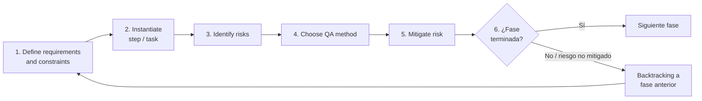
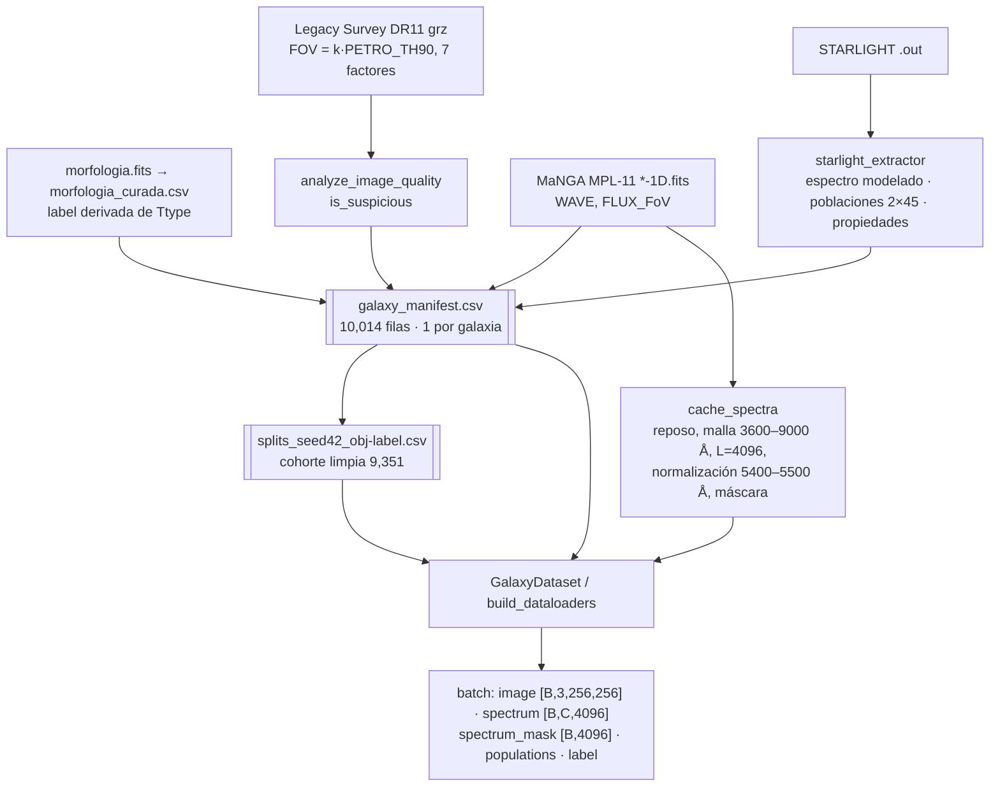
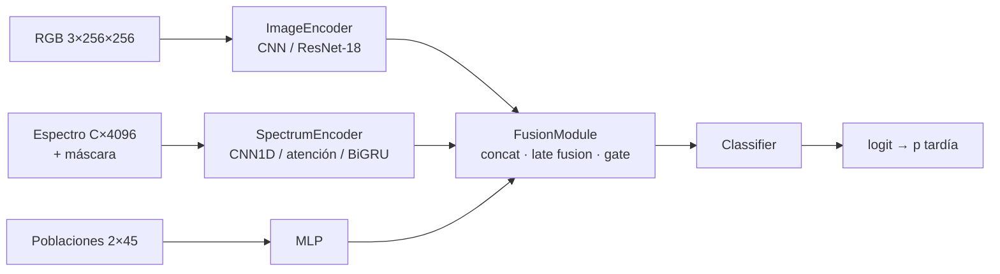
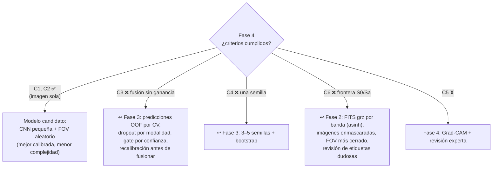

# Proyecto Integrador: Clasificación morfológica de galaxias usando espectros e imágenes

## Documentación del proceso con CRISP-ML(Q): Fase 2 (Preparación de los datos), Fase 3 (Modelado) y Fase 4 (Evaluación)

> **Marco metodológico:** CRISP-ML(Q), *Cross-Industry Standard Process for the development of Machine Learning applications with Quality assurance methodology* (Studer et al., 2021).
> **Evidencia:** notebooks, guías y artefactos de [`Melonangie/Galaxy-Vision/Notebooks/julio`](https://github.com/Melonangie/Galaxy-Vision/tree/main/Notebooks/julio).
> **Alcance:** este documento no resume CRISP-ML(Q). Usa su estructura de tareas y su ciclo de aseguramiento de calidad para documentar las fases 2, 3 y 4 del proyecto. Se usan los nombres de las tareas en inglés, como en el artículo, con su traducción al español.

---

## 0. Planteamiento del proyecto (reestructurado)

Esta sección reorganiza el enunciado original sin cambiar su significado. Las mejoras propuestas aparecen marcadas como **💡 Sugerencia**.

### 0.1 Objetivo

| Elemento | Definición |
|---|---|
| Tarea de ML | Clasificación **binaria** supervisada |
| Variable objetivo | Columna `Ttype` de `morfologia.fits` |
| Clase 0, **temprana** (*early-type*) | `Ttype ≤ 0` (E, S0, S0a) |
| Clase 1, **tardía** (*late-type*) | `1 ≤ Ttype ≤ 10` (Sa … Irr) |
| Requisito principal | Una clasificación **lo más fiable posible** |
| Modalidades | **Imágenes** (Legacy Survey, bandas *grz*) y **espectros** integrados MaNGA |

> 💡 **Sugerencia (criterios de éxito).** "Lo más fiable posible" debe convertirse en criterios de éxito medibles en la fase 1 (*Business & Data Understanding*). Sin ellos, la tarea final de la fase 4 (*Compare results with defined success criteria*) no se puede cerrar. En la §4.6 se proponen criterios concretos.

### 0.2 Fuentes de datos

| Fuente | Contenido | Uso en el proyecto |
|---|---|---|
| `morfologia.fits` (curado como `morfologia_curada.csv`) | `name`, `objra`, `objdec`, `Type`, `Ttype`, `nsa_z`, `LogMass`, `incl`, `PETRO_TH90` | Etiquetas, llave de integración (`name`) y tamaño angular para el zoom |
| [legacysurvey.org](https://www.legacysurvey.org) | Cutouts *grz* (DR11) | Modalidad visual |
| MaNGA MPL-11 (`manga-<plate>-<ifu>-1D.fits`) | `WAVE`, `FLUX_1RE`, `FLUX_FoV`, `ERROR_1RE`, `ERROR_FoV` | Modalidad espectral; primero se usa **`FLUX_FoV`** |
| Ajustes STARLIGHT (`.out`) | Espectro modelado, 45 poblaciones (BC03) y propiedades derivadas | Modalidad espectral modelada y "poblaciones estelares" |

### 0.3 Consignas técnicas del enunciado

1. **Imágenes en escala natural.** Se pueden "acercar" o "alejar" con `PETRO_TH90`, que es el radio que contiene el 90 % de la luz, modificando el parámetro `scale`/`pixscale` del servicio.
2. **Procesamiento de imagen.** Se pide descargar las imágenes originales en **FITS por banda** (*g*, *r*, *z*).
3. **Espectros.** Cada galaxia tiene uno a 1 radio efectivo (1RE) y otro al campo de visión del IFU (FoV). Las primeras pruebas usan **`WAVE` + `FLUX_FoV`**.
4. **STARLIGHT.** Los ajustes ([starlight.ufsc.br](http://www.starlight.ufsc.br)) se proporcionan como insumo adicional.

---

## 1. Cómo se aplica CRISP-ML(Q) en este proyecto

CRISP-ML(Q) pide que **cada fase** aplique el mismo ciclo de aseguramiento de calidad (*quality assurance*, Fig. 2 del artículo). Ese ciclo es la plantilla que se sigue en las fases 2, 3 y 4:



En el proyecto, las fases se encadenan así (en gris, las que quedan fuera del alcance de este documento):


**Plantilla usada en cada tarea:** requisitos → qué se hizo y en qué notebook → riesgos → método de QA y mitigación → estado y 💡 sugerencias.

---

## 2. FASE 2: Preparación de los datos (*Data Preparation*)

**Propósito en CRISP-ML(Q):** construir, a partir de los datos crudos, un **conjunto de datos y un pipeline de preparación** listos para el modelado. Las decisiones se basan en la fase 1 y deben quedar documentadas y ser reproducibles.

### 2.0 Requisitos y restricciones de la fase

| Requisito o restricción | Cómo se concreta en el proyecto |
|---|---|
| Integración determinista de modalidades | Llave única `name` (`manga-<plate>-<ifu>`); nunca se usa el orden de los archivos |
| No modificar los datos originales | Todo lo derivado va a `data/processed/` y a cachés con su configuración |
| Sin *data leakage* | Splits persistentes; estadísticas solo con *train*; variables morfológicas prohibidas como entrada |
| Trazabilidad | Manifest maestro, `download_index.csv`, `metadata.json` y `index.csv` de cada caché |
| Costo computacional acotado | ~10 mil galaxias; los FITS no se abren en cada época (caché `.npy`) |

### 2.0.1 Mapa de notebooks a tareas de la fase 2

| Tarea CRISP-ML(Q) | Notebook o artefacto en `julio/` |
|---|---|
| 3.2.1 *Select Data* | `generar_manifest_galaxias.ipynb`, `eda_espectros_manga.ipynb`, `markdowns/EXPERIMENT_GUIDELINES.md` §11 |
| 3.2.2 *Clean Data* | `exploracion_rgb_manga.ipynb` (detector de calidad), `image-curation.ipynb` (máscara de la galaxia central), `src.dataloader.spectra` (máscaras de validez) |
| 3.2.3 *Construct Data* | `legacy_cutouts_playground.ipynb`, `exploracion_fov_cutouts.ipynb`, `dynamic_fov_downloader.ipynb` (FOV adaptativo); extractor STARLIGHT |
| 3.2.4 *Standardize Data* | `dataloader_multimodal.ipynb`, `src.dataloader.cache_spectra` |

Flujo de datos resultante:



---

### 2.1 *Select Data* (selección de datos), §3.2.1

#### a) *Feature selection* (selección de características y modalidades)

En este proyecto la selección se hace primero **por modalidad** y después **por variable**:

| Entrada | Decisión | Motivo |
|---|---|---|
| Imagen RGB *grz* | ✅ Entrada principal | La etiqueta es morfológica; la estructura (bulbo, disco, brazos) es visible |
| Espectro `FLUX_FoV` | ✅ Primera apertura (consigna del enunciado) | Integra toda la galaxia en el campo del IFU |
| Espectro `FLUX_1RE` | ⏸ Ablación posterior | Ya hay caché `spectra_cache_1RE`; se reserva para comparar |
| `ERROR_FoV` / `ERROR_1RE` | ⏸ No se usa como canal | Primero hay que verificar su significado físico (1σ) |
| Poblaciones STARLIGHT (2 × 45 = 90 valores) | ✅ Modalidad derivada | Compacta e interpretable (luz y masa por edad y metalicidad) |
| `label`, `Ttype`, `Type`, `name` | ⛔ **Prohibidas** como entrada | Son la etiqueta, la definen o son identificadores (*leakage*) |
| `nsa_z`, `LogMass`, `PETRO_TH90`, `final_pixscale` | 🧪 Solo en "experimentos de contexto" | Pueden mejorar la métrica sin que el modelo aprenda morfología |
| `incl` | ⚠️ Procedencia por verificar | Puede venir de otra clasificación morfológica (fuga indirecta) |
| `objra`, `objdec` | ⛔ Como entrada · ✅ para detectar duplicados | Sin valor físico predictivo |

**Riesgo CRISP-ML(Q): correlaciones espurias ("Clever Hans").** El artículo advierte que un modelo puede aprender un atajo en lugar del concepto. En este proyecto hay tres atajos posibles:
1. `pixscale = k·PETRO_TH90/256` codifica el tamaño angular, que correlaciona con el tipo.
2. Las estrellas o vecinas del recuadro.
3. El fondo negro artificial que deja la máscara.

**Mitigación:** las guías separan **A. clasificación visual/espectroscópica** de **B. clasificación enriquecida con contexto** (§11.4) y piden reportar los dos casos por separado.

#### b) *Data selection* (selección de muestras)

CRISP-ML(Q) pide descartar muestras **solo con criterios objetivos y documentados**. El embudo del proyecto es:

| Paso | Criterio | Galaxias |
|---|---|---:|
| Catálogo curado | `Ttype` dentro de las reglas, con `PETRO_TH90` y coordenadas válidas (`legacy_cutouts_playground` §2) | 10,014 |
| JPEG disponible por FOV | Estado `downloaded`/`cached` **y** archivo existente en disco | 10,006 |
| FITS MaNGA disponible | Existe `data/MPL-11/<name>-1D.fits` | 10,013 |
| **Cohorte limpia (split)** | Imagen disponible y **no sospechosa** en FOV `+1`, `0` y `-1`; con FITS; caché espectral `ready` | **9,351** |

Las decisiones de calidad son explícitas. `is_suspicious` es una **heurística de revisión**, no un criterio automático de descarte permanente: la fila sigue en el manifest y solo sale de la cohorte del baseline. Si un espectro no se puede normalizar, se marca con `status=error` y un motivo; **nunca se elimina en silencio** dentro de `GalaxyDataset`.

#### c) *Unbalanced Classes* (clases desbalanceadas)


| | Tardía | Temprana | Proporción |
|---|---:|---:|---|
| Train | 4,078 | 2,467 | 62.3 % / 37.7 % |
| Validation | 874 | 529 | idem |
| Test | 875 | 528 | idem |

**Decisión:** el desbalance es moderado (≈ 1.65 : 1). No se aplica sobremuestreo ni submuestreo. Se mitiga con:
- un **split estratificado** 70/15/15 por `label` (semilla 42);
- **métricas que no dependen de la prevalencia** (ROC-AUC, balanced accuracy, macro-F1);
- un umbral elegido en *validation* cuando hace falta.

> 💡 **Sugerencia.** CRISP-ML(Q) recomienda **comparar técnicas de muestreo**. Una ablación barata sería `pos_weight` en la BCE (o *focal loss*) frente a la línea actual. El síntoma que lo justifica está en la §4.1: los modelos espectrales base tenían un recall de tempranas de 0.64–0.68.

#### d) División de datos (prerrequisito anti-*leakage*)
- Hay **un único split persistente** (`splits_seed42_obj-label.csv`) que reutilizan todos los experimentos. Los siete FOV de una galaxia caen siempre en el mismo conjunto porque comparten fila e ID.
- Se verificó que el split de imagen y el `_FoV` asignan exactamente las mismas galaxias, así que las métricas de test son comparables entre modalidades.
- 💡 **Sugerencia:** buscar duplicados físicos (la misma galaxia observada con dos IFU) por coordenadas y agrupar con un `group_id`, como piden las guías (§5.2).

---

### 2.2 *Clean Data* (limpieza de datos), §3.2.2

#### a) *Noise reduction* (reducción de ruido y artefactos)

| Modalidad | Problema | Método implementado | Notebook |
|---|---|---|---|
| Imagen | Líneas o artefactos de satélite, contaminación brillante, saturación | Detector heurístico explicable: mapa `max(R,G,B)`, z-score robusto (mediana/MAD), perfiles por fila y columna, componentes conexos → `line_flag`, `bright_flag` → `is_suspicious` | `exploracion_rgb_manga.ipynb` §11–22 |
| Imagen | Estrellas de campo alrededor de la galaxia | Máscara de color por imagen: distancia de Mahalanobis entre el color galaxia (centro) y el del cielo (borde), seguida de apertura morfológica y la **componente conexa central** | `image-curation.ipynb`, `dynamic_fov_downloader.ipynb` |
| Espectro | NaN, ±∞, píxeles sin cobertura | **Máscara de validez** que viaja con el tensor (`spectrum_mask [B, L]`); pooling enmascarado | `src.dataloader.spectra` |
| Espectro STARLIGHT | Píxeles sin dato observado (`wei = -2`) | Se escriben como NaN para no confundir modelo extrapolado con dato | Extractor STARLIGHT |

CRISP-ML(Q) pide **documentar y evaluar** el filtrado. El proyecto cumple: en la muestra de 1,000 galaxias, `line_flag` se activó en el **1.9 %** de los casos, hay revisión visual de verdaderos y falsos positivos, y las limitaciones están escritas (vecinas superpuestas sin *deblending*, discos externos débiles que se pierden).

> 💡 **Sugerencia.** Las imágenes enmascaradas (`jpg_masked/`) todavía no se han usado en ningún experimento de la fase 3. Una ablación "original vs. enmascarada" permitiría medir el efecto real de la limpieza y detectar el atajo del "fondo negro".

#### b) *Data imputation* (imputación)

**Decisión: no imputar flujos espectrales.** No se extrapola fuera de la cobertura. Los valores de relleno se ponen a 0 *después* de normalizar y la máscara impide que dominen el pooling o la atención. Esta opción es más segura que imputar por media o interpolación, que CRISP-ML(Q) pide comparar y documentar. Para los metadatos tabulares, las guías (§11.3) exigen una imputación documentada, ajustada solo con *train* y con máscara de ausencia.

---

### 2.3 *Construct Data* (construcción de datos), §3.2.3

#### a) *Feature engineering* con conocimiento del dominio

**1. Zoom adaptativo con `PETRO_TH90` (consigna del enunciado).** El servicio recibe `size` (256 px) y `pixscale` (″/px), no un "zoom". El proyecto define:

$$\text{FOV} = k \cdot \text{PETRO\_TH90}, \qquad \text{pixscale} = \frac{\text{FOV}}{256}$$


| Experimento de construcción | Variable estudiada | Notebook |
|---|---|---|
| A. Campo de visión | `fov_factor ∈ {4, 5, 6, 8}` con release y bandas fijos ("una variable por experimento") | `legacy_cutouts_playground.ipynb` |
| Límite de resolución | Si `pixscale` llega a `PIXSCALE_MIN` (0.1″/px), cerrar más el FOV no añade detalle físico | `exploracion_fov_cutouts.ipynb` §3, §7 |
| FOV simulado frente a real | Recortar una imagen FOV 8 no recupera el detalle de pedir un `pixscale` menor | `exploracion_fov_cutouts.ipynb` §8, `dynamic_fov_downloader.ipynb` |
| Dataset de producción | 7 variantes por galaxia (`+3 … 0 … −3` alrededor del factor de referencia), DR11, *grz*, 256², JPEG | `generar_manifest_galaxias.ipynb` |

**2. Espectros en marco de reposo y en una malla común.**
- Corrección por redshift: $\lambda_{rest} = \lambda_{obs}/(1+z)$ con `nsa_z`, aplicada **una sola vez**. El EDA confirmó que `WAVE` está en marco observado.
- Malla común de 3600–9000 Å en reposo con L = 4096 muestras. Para STARLIGHT se usa 3600–8900 Å, porque el ajuste termina en 8900 Å.

**3. Poblaciones estelares STARLIGHT** (*feature engineering* físico). La matriz `[2, 45]` contiene la fracción en luz `x_j` y la fracción en masa por edad y metalicidad. Las propiedades derivadas son edad media (luz/masa), metalicidad, `light_young_lt_100myr_pct`, `mass_old_ge_1gyr_pct`, extinción y dispersión de velocidades. Todo deriva del **mismo espectro FoV**, así que no es una observación independiente; las guías lo dejan registrado.

CRISP-ML(Q) pide **comparar cada transformación contra una línea base**. El proyecto lo hace en la fase 3: poblaciones (90 valores) frente al espectro crudo con la misma estructura de entrenamiento (§3.4).

#### b) *Data augmentation* (aumentación de datos)

| Transformación | Se aplica en | ¿Conserva la etiqueta? |
|---|---|---|
| Rotaciones de 90°·n | Solo *train* | ✅ La morfología no depende de la orientación |
| Flips horizontal y vertical | Solo *train* | ✅ |
| **Selección aleatoria de FOV** (`train_fov_columns = [fov_-1, fov_0, fov_+1]`) | Solo *train*; *val* y *test* usan siempre `fov_0` | ✅ Aumentación con conocimiento del dominio: varía la escala de forma realista |
| Cambios agresivos de color o brillo | ⛔ Evitados | Destruirían información astrofísica (el color está correlacionado con el tipo) |

> 💡 **Sugerencia (espectros).** CRISP-ML(Q) menciona el **ruido gaussiano**. Para espectros, ruido escalado con `ERROR_FoV` (una vez verificado) o enmascarado aleatorio de ventanas sería una aumentación que conserva la etiqueta y ayudaría con el sobreajuste rápido de la rama FoV (§3.4).

---

### 2.4 *Standardize Data* (estandarización), §3.2.4

#### a) *File format* (formato de archivo)

| Artefacto | Formato | Papel |
|---|---|---|
| `galaxy_manifest.csv` | CSV, una fila por galaxia | **Fuente de verdad** de la disponibilidad (por FOV, FITS e insumos STARLIGHT) |
| `download_index.csv` (×7) | CSV | Trazabilidad de cada descarga (`fov_requested_arcsec`, `fov_effective_arcsec`, `pixscale`, `layer`, `bands`, `status`) |
| Cachés espectrales | `tensors/<name>.npy`, `masks/<name>.npy`, `index.csv`, `metadata.json` (huellas de configuración y cohorte) | Evita abrir y descomprimir ~10 mil FITS en cada época |
| Insumos STARLIGHT | FITS con el mismo esquema que MaNGA (`WAVE`, `FLUX_FoV`) + `.npz` + `.json` | Reutiliza el dataloader espectral sin cambios |
| Batch | Contrato fijo: `image [B,3,256,256]`, `spectrum [B,C,4096]`, `spectrum_mask [B,4096]`, `populations`, `label` | Un solo *training loop* para todas las arquitecturas |

#### b) *Normalization* (normalización)

| Modalidad | Método | Cumplimiento de la regla "ajustar en train y aplicar igual en test" |
|---|---|---|
| Imagen | `none` → [0, 1]; `imagenet` si el encoder es preentrenado | Constante, sin estadísticas aprendidas |
| Espectro | **Por muestra:** se divide por la mediana del flujo en la ventana de continuo de 5400–5500 Å (≥ 5 muestras válidas); modos `per_channel` o `shared` | Es física y por muestra, así que no hay fuga. Si se añade una estandarización global, debe ajustarse solo con *train* |
| Poblaciones | Renormalización de `x_j` (su suma no es exactamente 100 %) | Por muestra |
| Metadatos | Estandarización e imputación | **Solo con *train*** y guardadas junto al modelo |

---

### 2.5 Riesgos y aseguramiento de calidad de la fase 2

| # | Riesgo identificado | Método de QA o mitigación | Estado |
|---|---|---|---|
| R2.1 | Desalineación entre galaxia, imagen y espectro | Unión por `name` con unicidad obligatoria (el generador falla si hay duplicados) | ✅ |
| R2.2 | Imagen "disponible" pero ausente en disco | Disponibilidad = `status` **y** existencia del archivo | ✅ |
| R2.3 | Artefactos y contaminación en las imágenes | `is_suspicious` + revisión visual + cohorte limpia | ✅ |
| R2.4 | Doble corrección por redshift | Una sola corrección; `Z` en la cabecera de los FITS STARLIGHT validado contra `nsa_z` | ✅ |
| R2.5 | Valores de relleno interpretados como datos | Máscara de validez propagada al modelo | ✅ |
| R2.6 | Fuga por variables morfológicas o por estadísticas de test | Lista de variables prohibidas; estadísticas solo con *train*; split persistente | ✅ |
| R2.7 | Atajo por la escala (`pixscale`, `PETRO_TH90`) | Experimentos A/B separados | ⚠️ Pendiente de medir |
| R2.8 | Grupos de galaxias duplicadas | Agrupar por coordenadas | ⚠️ Pendiente |
| R2.9 | **Se usan JPEG del visor y no FITS por banda** | Ver sugerencia | ❌ Diferencia con la consigna |

> 💡 **Sugerencia principal de la fase 2 (R2.9).** El enunciado pide descargar **FITS por banda *g, r, z*** para el procesamiento de imagen. El pipeline actual usa **JPEG renderizados por el visor** (`ls-dr11`, *grz*). El notebook `exploracion_rgb_manga` lo reconoce: sus métricas "describen el JPEG estirado del visor, no flujos fotométricos calibrados". Lo coherente con CRISP-ML(Q) es **retroceder (backtracking) a la tarea *Construct/Standardize Data*** y añadir una variante FITS:
> 1. Descargar `cutout.fits?layer=ls-dr11&bands=grz&pixscale=…` con el mismo `FOV = k·PETRO_TH90`.
> 2. Estandarizar por banda: restar el cielo (mediana sigma-clipped) y aplicar un estiramiento `asinh` o una normalización robusta por percentiles.
> 3. Construir un tensor `[3, 256, 256]` de flotantes con rango dinámico completo.
> 4. Compararlo contra el baseline JPEG con el **mismo split y la misma arquitectura**.
>
> Así se cumple la consigna y se pone a prueba si el estiramiento del visor limita la separación en la frontera S0/Sa (§4.2).

**Criterio de salida de la fase 2 (paso 6 del ciclo QA):** existen un manifest validado, un split persistente, cachés `ready` para toda la cohorte y un DataLoader que pasa las pruebas del contrato del batch (`dataloader_multimodal.ipynb`). ✅ Cumplido para la línea base JPEG + FoV; queda abierto para la variante FITS.

---

## 3. FASE 3: Modelado (*Modeling*)

**Propósito en CRISP-ML(Q):** elegir técnicas de modelado que cumplan los requisitos de calidad y documentar cómo se pasa del **universo de modelos** a un **subconjunto apropiado** y luego a un **ranking** (Fig. 3 del artículo).

```mermaid
flowchart LR
    U["Universo de modelos<br/>(CNN 2D, ViT, CNN 1D, RNN,<br/>MLP, GBM, fusiones…)"] -->|Requisitos: imágenes 256², espectros 4096,<br/>~6.5 k ejemplos de train, GPU única| S
    S["Subconjunto apropiado<br/>CNN pequeña · ResNet-18 · CNN1D ·<br/>CNN+atención · BiGRU · MLP · concat / late fusion"] -->|Medidas de calidad<br/>Tabla 2 de CRISP-ML(Q)| R
    R["Ranking<br/>1. Imagen (CNN / ResNet-18)<br/>2. Espectro con atención/BiGRU<br/>3. Poblaciones MLP<br/>4. Fusiones (sin ganancia demostrada)"]
```

### 3.1 *Literature research on similar problems* (revisión de literatura)

| Referencia | Aporte al proyecto |
|---|---|
| Dieleman, Willett & Dambre (2015, MNRAS) | CNN con invariancia a rotaciones para Galaxy Zoo; justifica la aumentación por rotaciones y flips |
| Domínguez Sánchez et al. (2018, MNRAS; 2022, catálogo MaNGA DL) | Clasificación de T-type con CNN en SDSS/MaNGA; referencia de desempeño para la **misma muestra** |
| Walmsley et al. (2022, Galaxy Zoo DECaLS / Zoobot) | Modelos **preentrenados en imágenes Legacy Survey**, candidatos a *transfer learning* |
| Cid Fernandes et al. (2005, STARLIGHT) | Base física de las poblaciones estelares usadas como características |

> 💡 **Sugerencia.** Citar en el informe el desempeño publicado sobre MaNGA para fijar el criterio de éxito del ML (§4.6) con un valor de referencia externo.

### 3.2 *Define quality measures of the model* (medidas de calidad, Tabla 2)

| Medida de CRISP-ML(Q) | Definición operativa en el proyecto | Evidencia actual |
|---|---|---|
| **Performance** | ROC-AUC (selección de checkpoint), balanced accuracy, macro-F1, recall por clase, matriz de confusión | `test_metrics.json`, `results.json` |
| **Robustness** | Estabilidad ante FOV, semillas, ruido y perturbaciones del espectro | FOV aleatorio probado; una sola semilla |
| **Scalability** | Tiempo por época con ~6.5 k galaxias | CNN: 715 s (CPU) → **27 s (GPU)**; ResNet-18: 18 s; espectro: 3–4 s; MLP: 1 s |
| **Explainability** | Plausibilidad física de la decisión | Poblaciones interpretables (edad y Z); Grad-CAM pendiente |
| **Model Complexity** | Número de parámetros frente al tamaño de los datos | CNN ≈ 1.2 M; ResNet-18 ≈ 11 M, sobreparametrizado para 6,545 ejemplos |
| **Resource Demand** | GPU única; cachés en disco (~328 MB para 10 k × 2 × 4096 float32) | ✅ |

> 💡 **Sugerencia (coherencia de métricas).** Las guías (§13) proponen **macro-F1** como métrica primaria y *validation loss* para el *early stopping*, pero los experimentos seleccionan el checkpoint por **ROC-AUC de validación**. Las dos opciones son válidas; lo que CRISP-ML(Q) exige es **documentar la decisión** y aplicarla de forma uniforme. Se recomienda declarar AUC como métrica de selección y balanced accuracy/macro-F1 como métricas de reporte.

### 3.3 *Model Selection* (selección de modelos)

CRISP-ML(Q) recomienda **empezar con modelos de baja capacidad** e ir subiendo (teorema *No Free Lunch*). El proyecto sigue esa escalera con un **diseño de ablación** (`EXPERIMENT_GUIDELINES.md` §14):

| Nivel | Experimento (carpeta en `experiments_out/`) | Modalidad | Arquitectura |
|---|---|---|---|
| Baseline visual (E1) | `experimento_binario_imagenes_cnn(_gpu)` | RGB `fov_0` | CNN de 4 bloques (32→256), desde cero |
| Control de capacidad | `imagenes_resnet18_fov` | RGB | ResNet-18 aleatorio + proyección 128 + MLP |
| Baseline espectral (E2) | `espectros_fov_cnn1d`, `espectros_starlight_cnn1d` | `FLUX_FoV` / STARLIGHT | CNN 1D con pooling enmascarado |
| Baseline físico | `poblaciones_starlight_mlp` | 90 valores | MLP (128) |
| Fusión básica (E3) | `multimodal_*_concat` (4 variantes) | Combinaciones | Encoders + **concatenación** |
| Más capacidad espectral (E4) | `espectros_{fov,starlight}_{cnn_attn_control, cnn_bigru, patch_bigru}` | Espectro | CNN + atención, CNN + BiGRU, patch-BiGRU |
| Fusión con espectro fuerte | `multimodal_imagenes_espectros_starlight_cnnattn_{fusion, image_only_control}` | RGB + STARLIGHT | ResNet-18 + CNN-atención |
| Aumentación de escala | `experimento_binario_imagenes_cnn_gpu_fov_aleatorio` | RGB `fov_{−1,0,+1}` | CNN pequeña |

Arquitectura modular común (un solo *training loop* para todas):



### 3.4 *Incorporate domain knowledge* (incorporación de conocimiento del dominio)

CRISP-ML(Q) pide validar cada aporte de conocimiento **por separado y contra una línea base**:

| Conocimiento del dominio | Dónde entra | ¿Validado de forma aislada? |
|---|---|---|
| Invariancia a rotaciones y flips | Aumentación | Parcial (hay aumentación, falta la ablación con y sin) |
| Escala relativa al tamaño (`PETRO_TH90`) | FOV adaptativo y FOV aleatorio | ✅ FOV aleatorio: AUC 0.9643 frente a 0.9623 (empate dentro del ruido; recall más equilibrado, 0.900/0.901) |
| Marco de reposo y continuo a 5400–5500 Å | Preprocesamiento espectral | Implícito |
| Pooling y atención enmascarados | Encoder espectral | ✅ Atención frente a CNN1D: +0.04 a +0.05 AUC |
| Síntesis de poblaciones | Modalidad STARLIGHT | ✅ 90 números (AUC 0.895) superan a la CNN1D sobre el espectro completo (0.857–0.864) |

### 3.5 *Model training* (entrenamiento)

| Componente | Configuración (`config.json`) |
|---|---|
| Función objetivo | BCE con logits |
| Optimizador | AdamW, *weight decay* 1e-4; LR 1e-4 (ablación) o **3e-4 + *gradient clipping* 1.0** (encoders mejorados) |
| Regularización | Dropout 0.3, *early stopping* (paciencia 8–10), aumentación |
| Selección | Checkpoint con el mejor **ROC-AUC de validación**; test se evalúa **una vez** con umbral 0.5 |
| Batch y épocas | 32; 50–60 como máximo |

**Diagnóstico de ajuste** (necesario para decidir qué modificar):


- **Imagen (ResNet-18 y fusiones):** sobreajuste a partir de la época ~13–24. El *early stopping* lo contiene.
- **Espectro con CNN1D:** subajuste. Durante 6–7 épocas predice la clase mayoritaria (balanced accuracy 0.50). Era un problema de **optimización**, no de falta de información: con LR 3e-4, *clipping* y atención el AUC sube a 0.90–0.917.
- **Poblaciones:** convergencia lenta y estable; el límite parece estar en la información, no en el modelo.

### 3.6 *Using unlabeled data and pre-trained models* (datos sin etiqueta y modelos preentrenados)

Todos los encoders se entrenaron **desde cero**. ResNet-18 sobreajusta con 6,545 ejemplos.
> 💡 **Sugerencia.** Hacer *transfer learning* con ImageNet (`normalization: imagenet` ya está soportado) y, sobre todo, con **Zoobot**, preentrenado con imágenes del mismo survey (DECaLS/Legacy). CRISP-ML(Q) indica que esta es la forma de reducir la necesidad de datos etiquetados.

### 3.7 *Model Compression* (compresión de modelos)

No es prioritario: no hay restricciones de despliegue en el borde y la CNN pequeña (≈ 1.2 M parámetros) **empata** con ResNet-18 (≈ 11 M). Esto ya es una "compresión por diseño", porque el modelo de menor complejidad ofrece la misma calidad.

### 3.8 *Ensemble methods* (métodos de ensamble)

- **Fusión temprana o intermedia (concat):** se entrenaron 4 variantes; ninguna supera a su rama visual.
- **Fusión tardía** $p = \alpha\,p_{RGB} + (1-\alpha)\,p_{otra}$ con α ajustado **solo en validation** (α* = 0.85): ΔAUC en test = +0.0005 [−0.0012, +0.0022].
- **Selector o gate por confianza** (diagnóstico con XGBoost y regresión logística): hay señal en `2·|p−0.5|` (AUC 0.676), pero **no hay ganancia neta demostrada**. No se justifica todavía un gate entrenado.

### 3.9 *Assure reproducibility* (asegurar la reproducibilidad), §3.3.1

| Subtarea de CRISP-ML(Q) | Implementación | Estado |
|---|---|---|
| ***Method reproducibility*** | Semilla 42; configuración declarativa (`config.json` por experimento: datos, modelo, LR, WD, paciencia, métrica de selección); split persistente; huellas de configuración en las cachés | ✅ |
| ***Result reproducibility*** | Varias semillas, con media ± desviación estándar | ❌ **Una sola semilla** por configuración |
| ***Experimental documentation*** | Por experimento: `config.json`, `history.csv`, `results.json`, `test_metrics.json`, `predictions.csv` (por galaxia); análisis en `ANALISIS_EXPERIMENTOS_ABLACION.md` | ✅ |

> 💡 **Sugerencia.** Fijar en el entorno `torch.backends.cudnn.deterministic` y las versiones de las librerías (`requirements.txt` con versiones exactas). Repetir **3–5 semillas** para ResNet-18 sola, Img+Pob e Img+Esp+Pob. Sin esto, las diferencias de ±0.002 AUC no se pueden ordenar.

### 3.10 Riesgos y QA de la fase 3

| # | Riesgo | Método de QA o mitigación | Estado |
|---|---|---|---|
| R3.1 | Sobreajuste de modelos de alta capacidad | *Early stopping*; comparar contra una CNN de menor capacidad | ✅ Contenido · 💡 Aumentación + *scheduler* |
| R3.2 | Confundir el efecto de la arquitectura con el de la optimización | Controles: `cnn_attn_control` (sin recurrencia) y `image_only_control` (misma optimización) | ✅ Bien diseñado |
| R3.3 | La rama dominante "memoriza" en la fusión | Comparar contra el control solo con imagen | ⚠️ La fusión concat con espectro fuerte **empeora** (0.933 frente a 0.967) · 💡 Dropout por modalidad, pérdidas auxiliares |
| R3.4 | Varianza de entrenamiento no cuantificada | Varias semillas | ❌ Pendiente |
| R3.5 | Sobreajuste de la selección a *validation* | Test se evalúa una vez | ⚠️ Ver §4.1 |

---

## 4. FASE 4: Evaluación (*Evaluation*)

**Propósito en CRISP-ML(Q):** validar que el modelo **cumple los criterios de éxito** antes del despliegue, con cuatro tareas: *validate performance*, *determine robustness*, *increase explainability* y *compare results with defined success criteria*.

### 4.1 *Validate performance* (validar el desempeño)

**Requisito de CRISP-ML(Q):** un conjunto de prueba **ciego y disjunto**, sin *leakage*. En el proyecto, el test tiene 1,403 galaxias, está estratificado, comparte cohorte en todas las modalidades y nunca se usó para entrenar ni para elegir α o umbrales.


**Resultados principales (test, n = 1,403):**

| Experimento | AUC | Accuracy | F1 macro | Recall T | Recall L |
|---|---:|---:|---:|---:|---:|
| Img ResNet-18 · LR 3e-4 (control) | **0.9667** | 0.895 | — | 0.909 | 0.887 |
| Img + Esp SL + Pob (concat) | 0.9650 | 0.890 | 0.884 | 0.883 | 0.894 |
| Img CNN · FOV aleatorio | 0.9643 | 0.900 | **0.895** | 0.900 | 0.901 |
| Img ResNet-18 (control, LR 1e-4) | 0.9633 | 0.888 | 0.881 | 0.860 | 0.905 |
| Img CNN pequeña (GPU) | 0.9623 | 0.901 | 0.895 | 0.892 | 0.906 |
| Img + Esp SL atención (concat) | 0.9334 | 0.862 | — | 0.902 | 0.838 |
| Espectro FoV · patch-BiGRU | 0.9170 | 0.853 | 0.845 | 0.839 | 0.861 |
| Espectro SL · CNN + atención | 0.9066 | 0.842 | 0.833 | 0.812 | 0.859 |
| Poblaciones MLP | 0.8949 | 0.838 | 0.828 | 0.799 | 0.861 |
| Espectro FoV · CNN1D (baseline) | 0.8572 | 0.795 | 0.777 | 0.682 | 0.863 |

Matrices de confusión (filas = real T/L; columnas = predicho T/L):

| ResNet-18 (control) | Img + Esp + Pob | Poblaciones |
|---|---|---|
| `[[454, 74], [83, 792]]` | `[[466, 62], [93, 782]]` | `[[422, 106], [122, 753]]` |

**Interpretación:**
1. Hay **tres escalones nítidos**: espectro (CNN1D ≈ 0.86; encoders mejorados ≈ 0.90–0.92) < poblaciones (≈ 0.90) < **imagen (≈ 0.96)**.
2. **Ninguna fusión supera de forma demostrable a la imagen sola.** El error estándar del AUC es ≈ ±0.005; las diferencias entre los modelos con imagen son ≤ 0.004. McNemar frente a ResNet da p = 0.14–1.0.
3. La accuracy con umbral 0.5 **confunde el ranking con el punto de operación**. Para comparar se usan AUC, balanced accuracy e IC por bootstrap pareado.

> ⚠️ **Riesgo de *leakage* por reutilización del test.** El propio análisis reconoce que los resultados de test se inspeccionaron antes del estudio de complementariedad. 💡 **Sugerencia:** decidir el modelo final solo con *validation* (o con validación cruzada OOF, como ya proponen las guías) y reservar una **evaluación final única**. Si el test ya influyó en decisiones, conviene declararlo o crear un *hold-out* nuevo.

### 4.2 Análisis de desempeño por segmentos (*sliced performance*)

CRISP-ML(Q) pide evaluar en **subconjuntos relevantes**, no solo en el total:


- **La frontera Ttype 0–1 (S0a / Sa) es el 16 % de la muestra y concentra el 48 % de los errores RGB.** Su tasa de error es del 33 %, frente al 7 % en el resto.
- Las poblaciones casi no separan Sa de S0 (51.7 % de error en Ttype 1). La dicotomía física es **continua** y el umbral `Ttype ≤ 0` es una frontera convencional sobre ella.
- 💡 **Sugerencia.** Completar los segmentos que piden las guías (§13.2): `nsa_z`, `LogMass`, inclinación, S/N espectral y `PETRO_TH90` (galaxias pequeñas, donde el FOV está limitado por el `pixscale` mínimo).

### 4.3 *Determine robustness* (determinar la robustez)

| Prueba | Resultado | Estado |
|---|---|---|
| Variación de escala (FOV aleatorio {−1, 0, +1} en train) | Mismo AUC y **recall más equilibrado** (0.900/0.901) | ✅ |
| Sensibilidad a hiperparámetros (LR 1e-4 → 3e-4 + *clipping*) | Imagen: 0.963 → 0.967; espectro: 0.86 → 0.90–0.92 | ✅ Identificado como factor crítico |
| IC por bootstrap pareado y McNemar | ResNet − poblaciones +0.068 [0.054, 0.084]; fusión tardía +0.0005 [−0.0012, 0.0022] | ✅ |
| Variabilidad entre semillas | — | ❌ |
| Evaluar el modelo en **FOV no vistos** (`±2`, `±3`) o con ruido añadido | — | 💡 Sugerido: el FOV es la perturbación natural del dominio |
| Calibración | ECE / Brier: CNN 0.014 / 0.072; ResNet-18 0.038 / 0.077; espectro con atención 0.024 / 0.117 | ✅ La CNN pequeña está mejor calibrada |

### 4.4 *Increase explainability for ML practitioner & end user* (aumentar la explicabilidad)

| Herramienta | Público | Estado |
|---|---|---|
| Galería de errores (`rgb_falla_pob_acierta`, etc.) | Usuario final (astrónomo) | ✅ Sugiere morfologías peculiares, alta inclinación y compañeras |
| Análisis por `Ttype` y propiedades STARLIGHT (corrección de Holm/Bonferroni) | Ambos | ✅ Ninguna propiedad física explica los errores |
| 9 galaxias con predicciones opuestas y ambas muy confiadas | Experto del dominio | ⚠️ Candidatas a **etiqueta dudosa**: revisar con la asesora o el asesor |
| Mapas de saliencia / **Grad-CAM** sobre la CNN | Desarrollador y usuario | 💡 Pendiente: confirmaría que la red mira el bulbo, el disco y los brazos, y no estrellas, bordes o el fondo (prueba "Clever Hans") |
| Atención espectral sobre λ | Usuario | 💡 Comprobar si el modelo pondera D4000, Hα, Hδ y Mg b |

### 4.5 *Compare results with defined success criteria* (comparar con los criterios de éxito)

Como la fase 1 no fijó criterios cuantitativos, se proponen los siguientes (💡). Deben validarse con la asesora o el asesor del proyecto:

| Criterio propuesto | Umbral | Resultado | Cumple |
|---|---|---|---|
| C1. Discriminación global | AUC test ≥ 0.95 | 0.962–0.967 (imagen) | ✅ |
| C2. Equilibrio entre clases | Balanced accuracy ≥ 0.88 y recall de tempranas ≥ 0.85 | 0.90 / 0.90 (CNN con FOV aleatorio) | ✅ |
| C3. Valor de la multimodalidad | La fusión supera a la imagen sola con un IC95 % que excluye el 0 | +0.0005 [−0.0012, +0.0022] | ❌ |
| C4. Reproducibilidad | ≥ 3 semillas, desviación estándar de AUC ≤ 0.005 | 1 semilla | ❌ |
| C5. Plausibilidad | Saliencia centrada en la galaxia, validada por un experto | Pendiente | ⏳ |
| C6. Frontera S0/Sa | Error en Ttype 0–1 < 25 % | 33 % | ❌ |

### 4.6 Decisión de la fase (paso 6 del ciclo QA) y *backtracking*

CRISP-ML(Q) indica que, si los criterios no se cumplen, se **retrocede** a la fase que corresponda:



**Conclusión de la evaluación:** el objetivo binario se cumple con **imágenes** (AUC ≈ 0.96, balanced accuracy ≈ 0.90). Las modalidades espectrales **sí contienen información complementaria**: corrigen alrededor del 50 % de los errores RGB, y un oráculo RGB ∪ poblaciones llegaría a 0.946 de accuracy. Pero **las técnicas de fusión probadas no la aprovechan todavía** (escenario B del análisis). Por eso la recomendación es retroceder a las fases 2 y 3 en los puntos indicados antes de pasar al despliegue.

---

## 5. Matriz de trazabilidad (tarea → notebook → artefacto)

| Fase | Tarea CRISP-ML(Q) | Notebook / módulo | Artefacto |
|---|---|---|---|
| 2 | Select Data | `generar_manifest_galaxias.ipynb` | `galaxy_manifest.csv`, `splits_seed42_obj-label.csv` |
| 2 | Select / Clean Data | `eda_espectros_manga.ipynb` | Inventario FITS, confirmación del marco observado |
| 2 | Clean Data | `exploracion_rgb_manga.ipynb`, `image-curation.ipynb` | `is_suspicious`, `jpg_masked/` |
| 2 | Construct Data | `legacy_cutouts_playground.ipynb`, `exploracion_fov_cutouts.ipynb`, `dynamic_fov_downloader.ipynb` | 7 datasets FOV + `download_index.csv` |
| 2 | Standardize Data | `dataloader_multimodal.ipynb`, `cache_spectra` | Cachés `.npy` + `metadata.json` |
| 3 | Model selection / training | `experiments/*.ipynb`, `experiments_fov/*.ipynb`, `template_experimento_binario.ipynb` | `experiments_out/<exp>/config.json`, `history.csv` |
| 3 | Reproducibility | `markdowns/EXPERIMENT_GUIDELINES.md` | Configuraciones, semilla, splits |
| 4 | Validate / robustness / explainability | `experiments/ANALISIS_EXPERIMENTOS_ABLACION.md` | `test_metrics.json`, `predictions.csv`, `figuras/curvas_entrenamiento.png` |

---

## 6. Resumen de sugerencias de mejora (priorizadas)

| Prioridad | Fase / tarea | Sugerencia | Por qué (CRISP-ML(Q)) |
|---|---|---|---|
| 🔴 Alta | 1 → 4 | Definir criterios de éxito cuantitativos (§4.5) | Sin ellos no se puede cerrar la fase 4 |
| 🔴 Alta | 2 · Construct/Standardize | Variante con **FITS *grz* por banda** frente a JPEG | Cumple la consigna; JPEG ≠ flujo calibrado |
| 🔴 Alta | 3 · Reproducibility | 3–5 semillas en los modelos finalistas | *Result reproducibility* |
| 🔴 Alta | 4 · Validate performance | Selección solo con validation/OOF y un *hold-out* final único | Evita *leakage* por reutilización del test |
| 🟠 Media | 3 · Pre-trained models | *Transfer learning* (ImageNet, Zoobot) | Reduce el sobreajuste de ResNet-18 |
| 🟠 Media | 4 · Explainability | Grad-CAM + revisión experta de las galaxias discordantes | Detecta atajos ("Clever Hans") y etiquetas ruidosas |
| 🟠 Media | 2 · Clean Data | Ablación con imagen original frente a enmascarada | Evaluar el filtrado, como pide la metodología |
| 🟡 Baja | 2 · Unbalanced classes | `pos_weight` o *focal loss* frente a la línea actual | Comparar técnicas de muestreo |
| 🟡 Baja | 2 · Select Data | Ablaciones 1RE frente a FoV y canales `ERROR` (una vez verificados) | Selección de características basada en evidencia |
| 🟡 Baja | 3 · Ensemble | Fusión tardía recalibrada y gate solo con más desacuerdos (OOF) | La señal existe, pero la ganancia neta no está demostrada |

---

*Referencia metodológica:* Studer, S., Bui, T. B., Drescher, C., Hanuschkin, A., Winkler, L., Peters, S., & Müller, K.-R. (2021). *Towards CRISP-ML(Q): A Machine Learning Process Model with Quality Assurance Methodology.* Machine Learning and Knowledge Extraction, 3(2), 392–413. arXiv:2003.05155.
