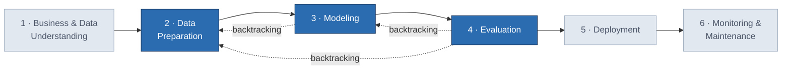

# Galaxy-Vision
## MNA Projecto Integrador

----

# Clasificación morfológica de galaxias con imágenes y espectros
## Fases 2, 3 y 4 de CRISP-ML(Q): preparación de datos, modelado y evaluación
> **Proyecto integrador.** Clasificación binaria **temprana vs. tardía** de galaxias MaNGA, combinando imágenes RGB de Legacy Survey con espectros integrados de MaNGA y ajustes de poblaciones estelares de STARLIGHT.
>
> **Marco metodológico.** *Towards CRISP-ML(Q): A Machine Learning Process Model with Quality Assurance Methodology* (Studer et al., 2021). Aquí no se usa CRISP-DM ni una metodología genérica.
>
> **Evidencia.** Todo lo que se reporta sale de los notebooks, artefactos y documentos de [`Notebooks/julio`](https://github.com/Melonangie/Galaxy-Vision/tree/main/Notebooks/julio), en particular de [`EXPERIMENT_GUIDELINES.md`](https://github.com/Melonangie/Galaxy-Vision/blob/main/Notebooks/julio/markdowns/EXPERIMENT_GUIDELINES.md), [`ANALISIS_EXPERIMENTOS_ABLACION.md`](https://github.com/Melonangie/Galaxy-Vision/blob/main/Notebooks/julio/experiments/ANALISIS_EXPERIMENTOS_ABLACION.md) y `experiments_out/*/results.json`.
---
## 0. Cómo se usa CRISP-ML(Q) en este documento
### 0.1 Ubicación de las fases 2–4 en el modelo de proceso
CRISP-ML(Q) organiza el ciclo de vida de una aplicación de ML en seis fases. Este documento cubre las fases 2, 3 y 4, que en la Tabla 1 del artículo corresponden a las fases centradas en los **datos** (2) y en el **modelo** (3 y 4).

### 0.2 El ciclo de aseguramiento de calidad (Figura 2 del artículo)
CRISP-ML(Q) aplica el mismo procedimiento de calidad a **cada tarea** de cada fase. Por eso cada tarea de este documento sigue la misma plantilla.
```mermaid
flowchart TD
    A[Iniciar fase CRISP-ML(Q)] --> B[Definir requisitos y restricciones]
    B --> C[Instanciar paso y tarea]
    C --> D[Identificar riesgos]
    D --> E{¿Riesgos<br/>aceptables?}
    E -- no --> F[Elegir método de<br/>aseguramiento de calidad]
    F --> G[Mitigar riesgos]
    G --> D
    E -- sí --> H{¿Fase<br/>terminada?}
    H -- no --> C
    H -- sí --> I[Iniciar la siguiente fase]
```
| Elemento de la plantilla | Significado en CRISP-ML(Q) | Contenido en este proyecto |
|---|---|---|
| **Requisitos y restricciones** | Lo que la tarea debe cumplir | Reglas de `EXPERIMENT_GUIDELINES.md` |
| **Instanciación** | Cómo se implementó la tarea | Notebook o módulo y decisión tomada |
| **Riesgos** | Qué puede comprometer el éxito o la eficiencia | Fuga de datos, sesgo, sobreajuste, etc. |
| **Método de QA** | Práctica que mitiga el riesgo | Prueba, control, ablación, IC, etc. |
| **Estado / evidencia** | Resultado verificable | Cifras, figuras y artefactos |
> 💡 **Sugerencia de mejora.** El artículo propone revisar documentos de salida al final de cada fase (§3.1.6). Al final de cada fase de este documento hay una lista de *salidas de la fase* y *riesgos abiertos* que puede usarse en esa revisión.
### 0.3 Entradas heredadas de la Fase 1
Las fases 2–4 se apoyan en el alcance y en los criterios de éxito de la Fase 1, que no se desarrolla aquí. La siguiente es una reformulación del objetivo con los tres niveles de criterios de éxito que pide CRISP-ML(Q) (§3.1.2). Los valores marcados como *propuesta* deben validarse con las asesoras.
| Nivel | Criterio | Fuente |
|---|---|---|
| **Negocio / científico** | Clasificar de forma fiable galaxias tempranas (Ttype ≤ 0) y tardías (1 ≤ Ttype ≤ 10) y comprobar si **combinar espectros e imágenes supera a una sola modalidad**. No existe un trabajo previo que combine ambos para este fin. | Planteamiento del proyecto |
| **ML** | Métrica principal independiente del umbral, **ROC-AUC**, junto con *balanced accuracy* y macro-F1. Para declarar que una fusión es mejor se exige una mejora sobre el control de imagen con un **IC 95 % que excluya 0**. *Propuesta:* AUC ≥ 0.95 en test como mínimo viable. | Guías §13 y análisis §8 |
| **Económico (KPI)** | *Propuesta:* horas de inspección visual experta ahorradas por cada 1,000 galaxias clasificadas automáticamente con confianza alta, y fracción de galaxias que se envían a revisión humana. | Sugerencia |
---
## Fase 2 · Preparación de datos (*Data Preparation*)
> **Propósito según CRISP-ML(Q):** producir el conjunto de datos 
Collapse 56 lines
