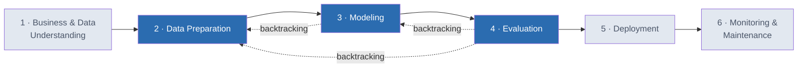
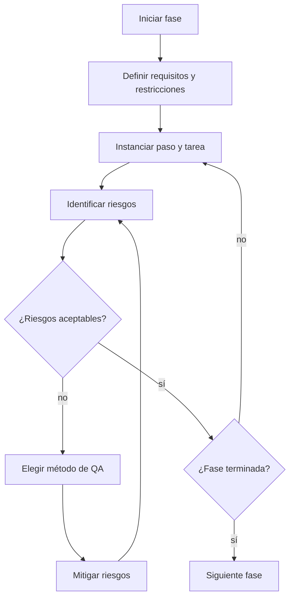
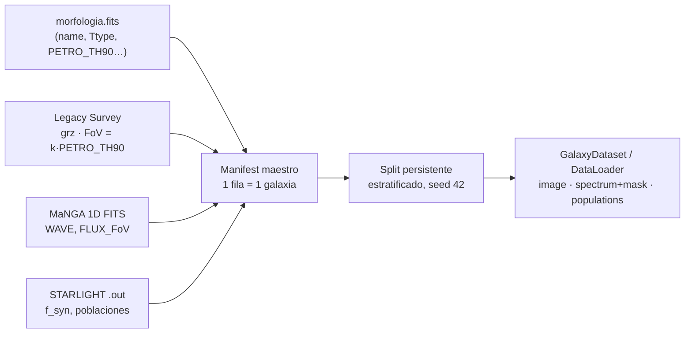
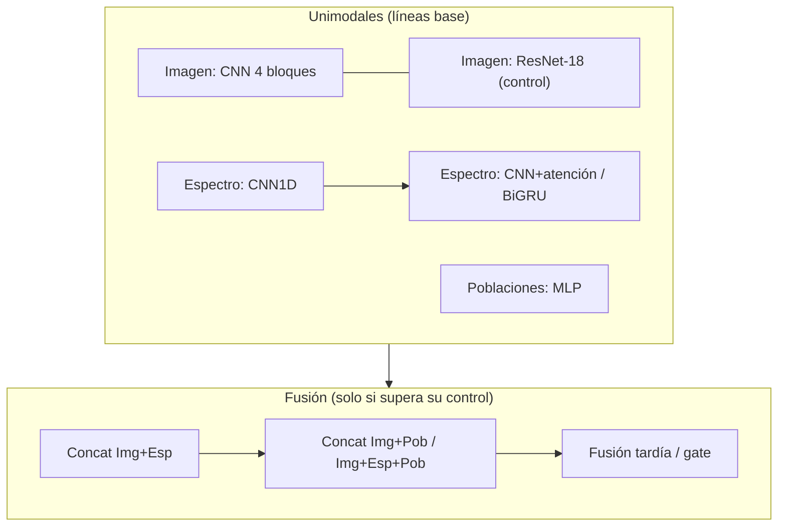
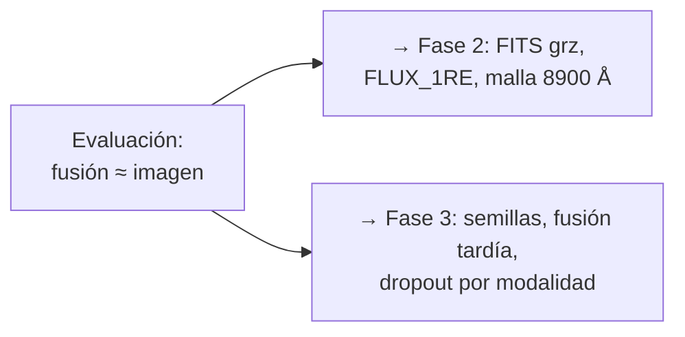

# Clasificación morfológica de galaxias

**User:** @maria-rabelero-mx_nestle

## @maria-rabelero-mx_nestle

Proyecto Integrador: Clasificación morfológica de galaxias usando espectros e imágenes

Objetivo
El primer objetivo será hacer una clasificación binaria entre tempranas y tardías, lo más fiable posible, usando tanto imágenes como la información del espectro.

Columna "Ttype":  tempranas <= 0, tardías >=1 y <=10

Datos
los datos con los que van a trabajar:
* la tabla que contiene el nombre de las galaxias a clasificar "morfologia.fits".
* las imágenes del sitio legacysurvey.org
* los espectros integrados del proyecto MaNGA. Estos se los adjunto en el archivo .zip.

Las imágenes se descargaran en su escala natural, sin embargo, es posible que en su caso necesiten adecuar el zoom de las galaxias para tener una mejor clasificación. Para ello pueden usar la información del radio aproximado de la galaxia ("PETRO_TH90")  y con ese variar la "scale" que es el valor que modifica el zoom. Para hacer un procesamiento de imagen, bajar las imágenes originales en formato .fits por cada banda (canal) grz.

Cada galaxia tiene un espectro a 1 radio efectivo y uno al tamaño de campo de visión del instrumento que se uso. En primer lugar usaría el espectro al tamaño de campo de visión para hacer las primeras pruebas, es decir, usar las columnas "WAVE" y "FLUX_FoV".
Los ajustes de los espectros integrados del proyecto MaNGA, hechos usando STARLIGHT http://www.starlight.ufsc.br. Estos se los adjunto en el archivo .zip.

Instrucciones
- Lee y analiza el PDF CRISP-ML(Q).pdf completo.
- Utiliza la terminología y organización de CRISP-ML(Q).pdf  
- No sustituyas CRISP-ML(Q) por CRISP-DM ni por una metodología genérica de Machine Learning. 
- No quiero un resumen de CRISP-ML(Q).pdf. Quiero utilizar la metodología CRISP-ML(Q).pdf como marco para desarrollar y documentar mi proyecto.
- Restructure messages and suggest improvements KEEP the original message meaning and points. 
- Curate information, explain it and expand it.
- Use images, tables, charts, when useful.

Usando https://github.com/Melonangie/Galaxy-Vision/tree/main/Notebooks/julio Explica las fases de la metodología que se usarán en el proyecto, usando solo las fases 2, 3 y 4 de CRISP-ML(Q) :
Preparación de los datos
Modelado
Evaluacion

## Copilot

Voy a revisar los cuadernos de `Notebooks/julio` y localizar el PDF para distinguir lo que ya está implementado de lo que conviene proponer en las fases 2, 3 y 4.

El PDF organiza la preparación en selección, limpieza, construcción y estandarización de datos, y exige controles de calidad en cada tarea. Los cuadernos ya permiten comparar modalidades, pero usan imágenes JPEG RGB: descargar y procesar las bandas `grz` en FITS sigue siendo una diferencia importante respecto a tu planteamiento.

# Clasificación morfológica de galaxias: aplicación de las fases 2, 3 y 4 de CRISP-ML(Q)

El proyecto buscará **clasificar galaxias tempranas y tardías de forma fiable y comprobar si combinar imágenes y espectros mejora la clasificación frente a utilizar cada fuente por separado**. La utilidad de la combinación debe demostrarse experimentalmente, no asumirse.

La organización siguiente se basa en la lectura completa de [CRISP-ML(Q).pdf](https://github.com/Melonangie/Galaxy-Vision/blob/main/documents/CRISP-ML%28Q%29.pdf), especialmente sus apartados 3.2, 3.3 y 3.4, y en los cuadernos de `Notebooks/julio`. Se distingue entre **lo documentado en el repositorio** y **las mejoras propuestas**; las métricas citadas proceden de los artefactos publicados, no de una nueva ejecución.

En CRISP-ML(Q), el aseguramiento de calidad acompaña cada tarea: se establecen requisitos y restricciones, se identifican riesgos y se aplican medidas para mitigarlos. Por ello, estas fases no se tratarán como una secuencia irreversible: la evaluación podrá exigir volver al modelado o a la preparación.

## Fase 2. Preparación de los datos — *Data Preparation*

**Propósito:** producir un conjunto de datos integrado, trazable y adecuado para entrenar modelos comparables. Siguiendo el apartado 3.2 del PDF, esta fase se organiza en **seleccionar, limpiar, construir y estandarizar datos**.

### 2.1. Seleccionar los datos — *Select Data*

La unidad de análisis será **una galaxia**, asociada mediante un identificador común a su etiqueta morfológica, sus imágenes y su espectro.

La variable objetivo conservará exactamente la definición del proyecto:

| Clase | Regla | Codificación |
|---|---|---:|
| Temprana | `Ttype ≤ 0` | 0 |
| Tardía | `1 ≤ Ttype ≤ 10` | 1 |

Los valores ausentes, códigos especiales y valores fuera de estas condiciones deberán revisarse y registrarse, sin asignarles una clase automáticamente. Como los cuadernos trabajan con `morfologia_curada.csv`, será necesario documentar su procedencia desde `morfologia.fits` y comprobar que la etiqueta curada respeta estas reglas.

Se seleccionarán inicialmente las siguientes entradas:

- **Imágenes de Legacy Survey**, con información de las bandas `g`, `r` y `z`.
- **Espectros integrados MaNGA**, utilizando primero `WAVE` y `FLUX_FoV`, como establece el planteamiento.
- **Resultados de STARLIGHT**, como representaciones alternativas del contenido espectral: espectro ajustado y poblaciones estelares.

STARLIGHT no aporta una observación independiente: sus productos derivan del espectro. Su utilidad consiste en comprobar si esa representación facilita extraer información relevante.

El cuaderno [generar_manifest_galaxias.ipynb](https://github.com/Melonangie/Galaxy-Vision/blob/main/Notebooks/julio/generar_manifest_galaxias.ipynb) construye un registro maestro o *manifest*, con una fila por galaxia, rutas, disponibilidad y alertas de calidad. Este mecanismo evita relacionar imágenes y espectros por el orden de los archivos.

**Control de calidad:** verificar correspondencias uno a uno y auditar posibles observaciones repetidas de una misma galaxia física. `Ttype`, `Type` y `label` no podrán utilizarse como predictores, porque contienen o determinan la respuesta.

### 2.2. Limpiar los datos — *Clean Data*

La limpieza buscará eliminar problemas de adquisición o representación **sin borrar información astronómica útil**.

| Fuente | Problema que debe revisarse | Tratamiento y control |
|---|---|---|
| Catálogo | Duplicados, etiquetas ausentes o inconsistentes | Registrar el problema y resolverlo antes de integrar modalidades. |
| Imágenes | Archivos corruptos, estrellas brillantes, artefactos o galaxias truncadas | Comprobar archivos y revisar visualmente casos señalados. |
| Espectros | Valores no finitos, cobertura insuficiente o normalización inválida | Generar máscaras de validez y registrar motivos de inelegibilidad. |
| STARLIGHT | Ajustes deficientes o unidades no verificadas | Separar controles de calidad de las variables físicas utilizadas como entradas. |

El repositorio explora máscaras para reducir contaminación estelar. Sin embargo, también documenta que pueden eliminar discos externos débiles. Por tanto, **el enmascaramiento se evaluará contra las imágenes originales**, en lugar de considerarlo una mejora automática.

Asimismo, la bandera `is_suspicious` es una alerta heurística, no una confirmación de que una imagen carece de valor científico. Si se utiliza para definir una cohorte limpia, se deberá medir qué tipos de galaxias quedan excluidos.

### 2.3. Construir los datos — *Construct Data*

**Imágenes y escala angular.** El campo de visión se adaptará al tamaño de la galaxia utilizando `PETRO_TH90`. Conceptualmente:

\[
\mathrm{FoV}=k\,\mathrm{PETRO\_TH90},
\qquad
\mathrm{pixscale}=\frac{\mathrm{FoV}}{N_{\mathrm{píxeles}}}.
\]

A tamaño de imagen fijo, un menor campo de visión produce mayor acercamiento. El parámetro elegido debe conservar bulbo, disco y estructuras externas relevantes, sin introducir demasiado fondo o contaminación.

Los cuadernos ya exploran distintos campos de visión. Su comparación debe realizarse conservando las mismas galaxias y particiones.

**Diferencia respecto al requisito original:** los experimentos revisados utilizan principalmente **JPEG RGB de 256 × 256 píxeles**, no imágenes científicas FITS por banda. Para cumplir el planteamiento de procesamiento por canales, se deberán descargar y conservar las bandas `grz` en FITS, verificar su alineación y documentar su transformación en tensores. Los JPEG pueden mantenerse como línea base, pero no equivalen a los flujos originales por banda.

**Representación espectral.** El [dataloader_multimodal.ipynb](https://github.com/Melonangie/Galaxy-Vision/blob/main/Notebooks/julio/dataloader_multimodal.ipynb) documenta un procesamiento que:

1. Lleva la longitud de onda al marco de reposo mediante \(\lambda_{\mathrm{reposo}}=\lambda_{\mathrm{observada}}/(1+z)\).
2. Normaliza cada espectro mediante la mediana del continuo entre 5400 y 5500 Å.
3. Interpola sobre una malla común, sin extrapolar.
4. Acompaña el tensor con una máscara para distinguir datos válidos de valores de relleno.

La configuración general utiliza 4096 muestras entre 3600 y 9000 Å. Para comparar con STARLIGHT deberá igualarse la cobertura —su caché documentada llega a 8900 Å—, evitando que la diferencia entre representaciones se confunda con una diferencia de rango espectral.

**Aumento de datos.** Las rotaciones y reflexiones que preservan la clase podrán aplicarse durante entrenamiento. No se aplicarán aleatoriamente a validación ni a prueba.

### 2.4. Estandarizar los datos — *Standardize Data*

Se fijarán formatos, unidades, dimensiones, parámetros de normalización y versiones del preprocesamiento. Las estadísticas aprendidas de la muestra —por ejemplo, imputación y escalado de variables tabulares— se estimarán **exclusivamente con entrenamiento**.

La documentación de julio registra esta cohorte experimental:

| Partición | Galaxias | Tempranas | Tardías |
|---|---:|---:|---:|
| Entrenamiento | 6545 | 2467 | 4078 |
| Validación | 1403 | 529 | 874 |
| Prueba | 1403 | 528 | 875 |
| **Total** | **9351** | **3524** | **5827** |

Todas las modalidades y variantes de imagen de una galaxia deberán permanecer en la misma partición.

**Salida de la fase:** conjunto integrado y versionado, *manifest*, particiones persistentes, descripción del preprocesamiento e informe de exclusiones. Para avanzar, deberán estar verificadas las etiquetas, correspondencias y formas de entrada, sin pérdidas silenciosas de objetos.

## Fase 3. Modelado — *Modeling*

**Propósito:** construir modelos que cumplan los requisitos científicos y de calidad, aumentando su complejidad únicamente cuando exista evidencia de utilidad.

El apartado 3.3 de CRISP-ML(Q) exige considerar, además del rendimiento, **robustez, escalabilidad, explicabilidad, complejidad y demanda de recursos**.

### 3.1. Selección de modelos y comparación controlada

El diseño experimental permitirá separar el aporte de cada entrada:

| Experimento | Modelo de referencia | Pregunta |
|---|---|---|
| Solo imágenes | CNN compacta y ResNet-18 | ¿Cuánto permite clasificar la información visual? |
| Solo espectros FoV | CNN 1D | ¿Cuánto aporta el espectro observado? |
| Espectros con mayor capacidad | CNN con atención o BiGRU | ¿La línea base espectral aprovecha suficientemente la señal? |
| Poblaciones STARLIGHT | MLP | ¿La representación física facilita la clasificación? |
| Imagen + espectro | Encoders separados y fusión | ¿La combinación supera a la imagen sola? |
| Imagen + productos STARLIGHT | Fusión de representaciones | ¿La información derivada añade valor? |

Estas comparaciones corresponden a **ablaciones**: retirar o incorporar componentes para determinar qué contribuye realmente al resultado.

Una fusión deberá compararse con un control visual equivalente en arquitectura y protocolo. De otro modo, una mejora podría deberse al encoder de imágenes y no al espectro.

### 3.2. Entrenamiento y regularización

Los experimentos revisados utilizan PyTorch, una salida binaria mediante *logit*, `BCEWithLogitsLoss` y AdamW. Varios incorporan *dropout*, penalización de pesos y parada temprana.

El entrenamiento se documentará separando tres funciones:

**Entrenamiento** ajusta los pesos; **validación** selecciona arquitectura, hiperparámetros, época y umbral; **prueba** estima el desempeño del procedimiento final fijado.

Existe una discrepancia documental que conviene resolver: las guías proponen macro-F1 como métrica comparativa y pérdida de validación para selección inicial, mientras varios cuadernos seleccionan por ROC-AUC de validación. El protocolo definitivo deberá declarar una regla coherente antes de nuevas comparaciones.

### 3.3. Asegurar la reproducibilidad — *Assure Reproducibility*

CRISP-ML(Q) distingue dos niveles:

**Reproducibilidad del método:** conservar código, datos, particiones, configuración, versiones, hardware y semillas.

**Reproducibilidad de los resultados:** repetir los experimentos finalistas con varias semillas y reportar media y dispersión, no únicamente la mejor corrida.

Los archivos `config.json`, `history.csv`, `results.json` y las predicciones por galaxia proporcionan una base para esta trazabilidad.

**Salida de la fase:** modelos candidatos, configuraciones, checkpoints y registro de decisiones. Un modelo más complejo solo se justificará si su beneficio compensa sus costes y riesgos.

## Fase 4. Evaluación — *Evaluation*

**Propósito:** determinar si los modelos satisfacen los criterios de éxito y si sus resultados son fiables, robustos y científicamente plausibles. La organización sigue las cuatro tareas del apartado 3.4 del PDF.

### 4.1. Validar el rendimiento — *Validate Performance*

Se reportarán ROC-AUC, macro-F1, *balanced accuracy*, precisión y sensibilidad por clase, además de la matriz de confusión.

La exactitud global no será suficiente: aproximadamente el 62 % de la cohorte corresponde a galaxias tardías, por lo que un clasificador que siempre predijera esa clase ya alcanzaría una exactitud cercana a 0.62.

Los artefactos publicados contienen, entre otros, estos resultados:

| Modelo o combinación | ROC-AUC de prueba | Exactitud |
|---|---:|---:|
| Espectro FoV, CNN 1D | 0.8572 | 0.7947 |
| Espectro FoV, *patch*-BiGRU | 0.9170 | 0.8525 |
| Poblaciones STARLIGHT, MLP | 0.8949 | 0.8375 |
| Imagen, ResNet-18 de control | 0.9633 | 0.8881 |
| Imagen + espectro FoV | 0.9635 | 0.8874 |
| Imagen + espectro STARLIGHT + poblaciones | 0.9650 | 0.8895 |

**Interpretación:** el espectro contiene información predictiva y su aprovechamiento depende de la arquitectura. Sin embargo, estos resultados no demuestran por sí solos que la fusión supere al modelo visual.

Además, una variante posterior de fusión con atención espectral registra AUC 0.9334 frente a 0.9667 de su control visual. Esto muestra que **añadir modalidades también puede perjudicar el desempeño**.

Para evaluar diferencias pequeñas se propone un *bootstrap* pareado por galaxia, complementado con repeticiones de entrenamiento. La incertidumbre del conjunto de prueba y la variabilidad entre semillas son problemas distintos.

### 4.2. Determinar la robustez — *Determine Robustness*

Se evaluará el rendimiento ante cambios plausibles de escala, ruido, centrado y cobertura espectral. También se realizarán análisis por subgrupos:

| Subgrupo | Riesgo que permite investigar |
|---|---|
| `Ttype`, especialmente 0 y 1 | Dificultad cerca de la frontera entre clases. |
| Tamaño angular y campo de visión | Dependencia del zoom o pérdida de estructuras. |
| Redshift e inclinación | Degradación por resolución aparente y orientación. |
| Calidad espectral | Dependencia de ruido o cobertura. |
| Objetos rechazados durante curación | Sesgo hacia galaxias más fáciles de clasificar. |

Cada resultado deberá acompañarse del número de galaxias evaluadas. El desempeño en una cohorte limpia no garantiza el mismo rendimiento en toda la muestra original.

### 4.3. Aumentar la explicabilidad — *Increase Explainability*

Se examinará qué información sostiene las predicciones mediante mapas de atribución u oclusión en imágenes y análisis de regiones espectrales relevantes.

La revisión con especialistas deberá comprobar si el modelo utiliza estructuras plausibles —bulbo, disco y brazos— o atajos como estrellas, bordes y artefactos. En espectros, permitirá contrastar la relevancia de continuos y líneas con su interpretación astrofísica.

Las explicaciones servirán para **detectar fallos y formular nuevas pruebas**, no para demostrar causalidad física.

### 4.4. Comparar con los criterios de éxito — *Compare Results with Defined Success Criteria*

Antes de una evaluación confirmatoria se deberán fijar los niveles mínimos aceptables de rendimiento, sensibilidad por clase y robustez. Si se pretende afirmar que la fusión mejora la clasificación, también se deberá definir una mejora mínima relevante frente al control visual.

**Limitación importante:** consultar prueba una vez por experimento no mantiene un ensayo ciego si sus resultados orientan experimentos posteriores. Si esto ha ocurrido, los resultados actuales deberán tratarse como exploratorios y la confirmación requerirá una muestra independiente o un protocolo externo de evaluación.

**Salida de la fase:** informe de rendimiento, incertidumbre, robustez, explicaciones y riesgos pendientes. La decisión será aceptar un candidato o regresar a preparación o modelado. Con la evidencia publicada, la conclusión defendible es que **las imágenes ofrecen la referencia más fuerte; el valor adicional de los espectros debe demostrarse, no darse por establecido**.

## @maria-rabelero-mx_nestle

Proyecto Integrador: Clasificación morfológica de galaxias usando espectros e imágenes

Objetivo
El primer objetivo será hacer una clasificación binaria entre tempranas y tardías, lo más fiable posible, usando tanto imágenes como la información del espectro.

Columna "Ttype":  tempranas <= 0, tardías >=1 y <=10

Datos
los datos con los que van a trabajar:
* la tabla que contiene el nombre de las galaxias a clasificar "morfologia.fits".
* las imágenes del sitio legacysurvey.org
* los espectros integrados del proyecto MaNGA. Estos se los adjunto en el archivo .zip.

Las imágenes se descargaran en su escala natural, sin embargo, es posible que en su caso necesiten adecuar el zoom de las galaxias para tener una mejor clasificación. Para ello pueden usar la información del radio aproximado de la galaxia ("PETRO_TH90")  y con ese variar la "scale" que es el valor que modifica el zoom. Para hacer un procesamiento de imagen, bajar las imágenes originales en formato .fits por cada banda (canal) grz.

Cada galaxia tiene un espectro a 1 radio efectivo y uno al tamaño de campo de visión del instrumento que se uso. En primer lugar usaría el espectro al tamaño de campo de visión para hacer las primeras pruebas, es decir, usar las columnas "WAVE" y "FLUX_FoV".
Los ajustes de los espectros integrados del proyecto MaNGA, hechos usando STARLIGHT http://www.starlight.ufsc.br. Estos se los adjunto en el archivo .zip.

Instrucciones
- Lee y analiza el PDF CRISP-ML(Q).pdf completo.
- Utiliza la terminología y organización de CRISP-ML(Q).pdf  
- No sustituyas CRISP-ML(Q) por CRISP-DM ni por una metodología genérica de Machine Learning. 
- No quiero un resumen de CRISP-ML(Q).pdf. Quiero utilizar la metodología CRISP-ML(Q).pdf como marco para desarrollar y documentar mi proyecto.
- Restructure messages and suggest improvements KEEP the original message meaning and points. 
- Curate information, explain it and expand it.
- Use images, tables, charts, when useful.

Usando https://github.com/Melonangie/Galaxy-Vision/tree/main/Notebooks/julio Explica las fases de la metodología que se usarán en el proyecto, usando solo las fases 2, 3 y 4 de CRISP-ML(Q) :
Preparación de los datos
Modelado
Evaluacion

## Copilot

# Clasificación morfológica de galaxias mediante imágenes y espectros
## Aplicación de las fases 2, 3 y 4 de CRISP-ML(Q)

El proyecto utilizará **CRISP-ML(Q) como marco para preparar los datos, construir modelos y evaluar su fiabilidad**, incorporando aseguramiento de calidad en cada tarea. El objetivo será clasificar galaxias tempranas y tardías y determinar experimentalmente si combinar imágenes y espectros mejora el resultado frente a utilizar una sola modalidad.

La organización siguiente corresponde a los apartados **3.2, 3.3 y 3.4 del [PDF CRISP-ML(Q)](https://github.com/Melonangie/Galaxy-Vision/blob/main/documents/CRISP-ML%28Q%29.pdf), leído completo**, y se aplica al trabajo documentado en `Notebooks/julio`. Se distinguen las prácticas existentes de las mejoras necesarias para completar el planteamiento original.

El principio transversal será: **definir requisitos, identificar riesgos, aplicar controles y conservar evidencia**. Si la evaluación revela problemas, se volverá al modelado o a la preparación de datos.

## 2. Preparación de los datos — *Data Preparation*

**Objetivo de la fase:** producir un conjunto de datos integrado, trazable y adecuado para comparar modelos. CRISP-ML(Q) organiza esta fase en cuatro tareas: **seleccionar, limpiar, construir y estandarizar datos**.

### 2.1. Seleccionar los datos — *Select Data*

La unidad de análisis será **una galaxia**, vinculada con su clasificación morfológica, sus imágenes y su espectro mediante un identificador común.

La etiqueta conservará exactamente la definición proporcionada:

| Clase | Condición sobre `Ttype` | Etiqueta |
|---|---|---:|
| Temprana | `Ttype ≤ 0` | 0 |
| Tardía | `1 ≤ Ttype ≤ 10` | 1 |

Los valores ausentes, códigos especiales o valores que no cumplan estas condiciones deberán revisarse y registrarse, sin asignarles una clase automáticamente.

La tabla original será `morfologia.fits`. Como los cuadernos trabajan con `morfologia_curada.csv`, será necesario documentar cómo se obtuvo esta versión y comprobar que conserva la correspondencia entre identificadores, `Ttype` y etiquetas.

Las entradas iniciales serán:

| Fuente | Información seleccionada | Función |
|---|---|---|
| Legacy Survey | Imágenes en bandas `g`, `r` y `z` | Representar estructura, distribución de luz y color. |
| MaNGA | `WAVE` y `FLUX_FoV` | Representar el espectro integrado sobre el campo de visión. |
| STARLIGHT | Espectro ajustado y poblaciones estelares | Evaluar representaciones derivadas de la información espectral. |

El espectro dentro de un radio efectivo, `FLUX_1RE`, quedará para una comparación posterior, manteniendo la prioridad original sobre `FLUX_FoV`.

**Aplicación existente.** El cuaderno [generar_manifest_galaxias.ipynb](https://github.com/Melonangie/Galaxy-Vision/blob/main/Notebooks/julio/generar_manifest_galaxias.ipynb) construye un registro maestro o *manifest*, con una fila por galaxia, rutas, disponibilidad y alertas de calidad.

**Aseguramiento de calidad.** Se comprobarán correspondencias uno a uno y posibles observaciones repetidas de una misma galaxia física. `Ttype`, `Type` y `label` no podrán entrar al clasificador como predictores, porque contienen o determinan la respuesta.

### 2.2. Limpiar los datos — *Clean Data*

La limpieza buscará corregir problemas técnicos **sin eliminar estructuras o señales astronómicas relevantes**.

| Datos | Riesgo | Medida de calidad |
|---|---|---|
| Catálogo | Duplicados o etiquetas inconsistentes | Validar identificadores y registrar correcciones. |
| Imágenes | Archivos corruptos, estrellas brillantes, artefactos o recortes incompletos | Verificar archivos y revisar casos señalados. |
| Espectros | Valores no finitos, cobertura insuficiente o continuo inválido | Crear máscaras y registrar motivos de inelegibilidad. |
| STARLIGHT | Ajustes deficientes o propiedades con unidades no verificadas | Auditar calidad y limitar el uso de variables no confirmadas. |

Los cuadernos exploran máscaras para reducir contaminación estelar. Sin embargo, también documentan que estas pueden eliminar discos externos débiles. Por ello, **se compararán imágenes originales y enmascaradas antes de adoptar la limpieza**.

La bandera `is_suspicious` se interpretará como una alerta heurística, no como prueba definitiva de inutilidad. Si se utiliza para excluir objetos, se analizará si afecta desproporcionadamente a una clase o tipo de galaxia.

### 2.3. Construir los datos — *Construct Data*

Esta tarea convertirá los archivos originales en representaciones adecuadas para los modelos.

**Imágenes y ajuste del zoom.** Se utilizará `PETRO_TH90` para adaptar el campo de visión al tamaño angular de cada galaxia. Conceptualmente:

\[
\mathrm{FoV}=k\,\mathrm{PETRO\_TH90},
\qquad
\mathrm{pixscale}=\frac{\mathrm{FoV}}{N_{\mathrm{píxeles}}}.
\]

A tamaño de imagen fijo, un menor campo de visión produce mayor acercamiento. La elección deberá conservar bulbo, disco y estructuras externas, evitando tanto recortar la galaxia como introducir demasiado fondo.

Los experimentos de julio ya exploran variantes de campo de visión. Estas deberán compararse utilizando las mismas galaxias y particiones.

**Diferencia pendiente respecto al planteamiento:** los experimentos revisados utilizan principalmente **JPEG RGB de 256 × 256 píxeles**, no imágenes científicas FITS por banda. Para cumplir el requisito original, se deberán descargar las bandas `grz` en FITS, verificar su alineación y documentar cómo sus valores se transforman en entradas del modelo. Los JPEG podrán conservarse como referencia experimental, pero no equivalen a los flujos originales.

**Espectros.** El [dataloader_multimodal.ipynb](https://github.com/Melonangie/Galaxy-Vision/blob/main/Notebooks/julio/dataloader_multimodal.ipynb) documenta un procesamiento que:

1. Convierte la longitud de onda observada al marco de reposo:
   \[
   \lambda_{\mathrm{reposo}}=\frac{\lambda_{\mathrm{observada}}}{1+z}.
   \]
2. Normaliza cada espectro mediante la mediana del continuo entre 5400 y 5500 Å.
3. Interpola sobre una malla común, sin extrapolar.
4. Genera una máscara para distinguir datos válidos de valores de relleno.

La configuración general utiliza **4096 muestras entre 3600 y 9000 Å**. Para comparar con STARLIGHT deberá igualarse la cobertura: su caché documentada llega a 8900 Å. Así se evitará confundir diferencias de representación con diferencias de rango espectral.

**Aumento de datos.** Durante entrenamiento podrán aplicarse rotaciones y reflexiones que preserven la clase morfológica. No se introducirán transformaciones aleatorias en validación ni en prueba.

### 2.4. Estandarizar los datos — *Standardize Data*

Se fijarán formatos, unidades, dimensiones, parámetros de normalización y versiones del preprocesamiento.

Las estadísticas aprendidas de la muestra —por ejemplo, imputación y escalado de variables tabulares— se estimarán **solo con entrenamiento** y se reutilizarán sin reajuste en validación y prueba.

La documentación de julio registra esta cohorte:

| Partición | Total | Tempranas | Tardías |
|---|---:|---:|---:|
| Entrenamiento | 6545 | 2467 | 4078 |
| Validación | 1403 | 529 | 874 |
| Prueba | 1403 | 528 | 875 |
| **Total** | **9351** | **3524** | **5827** |

Todas las modalidades y variantes de una galaxia deberán permanecer en la misma partición. También se justificará la reducción desde las 10 014 filas del catálogo curado hasta la cohorte experimental.

**Entregable y criterio de cierre:** conjunto integrado y versionado, *manifest*, particiones persistentes e informe de calidad y exclusiones. La fase finalizará cuando etiquetas, correspondencias y entradas estén verificadas, sin pérdidas silenciosas de objetos.

## 3. Modelado — *Modeling*

**Objetivo de la fase:** desarrollar modelos que satisfagan los requisitos del proyecto, aumentando su complejidad únicamente cuando exista evidencia de utilidad.

CRISP-ML(Q) establece seis dimensiones de calidad: **rendimiento, robustez, escalabilidad, explicabilidad, complejidad y demanda de recursos**. Por tanto, no se seleccionará automáticamente el modelo con mayor puntuación.

### 3.1. Selección de modelos y comparación de modalidades

Se comenzará con referencias sencillas y se incorporarán modelos más complejos de forma controlada.

| Configuración | Modelo documentado o de referencia | Pregunta experimental |
|---|---|---|
| Solo imágenes | CNN compacta y ResNet-18 | ¿Cuánto permite clasificar la información visual? |
| Solo espectros FoV | CNN 1D | ¿Cuánto aporta el espectro observado? |
| Espectros con mayor capacidad | CNN con atención o BiGRU | ¿La referencia espectral aprovecha suficientemente la señal? |
| Poblaciones STARLIGHT | MLP | ¿La representación física facilita la clasificación? |
| Imagen + espectro | Encoders separados y fusión | ¿La combinación supera a la imagen sola? |
| Imagen + productos STARLIGHT | Fusión de representaciones | ¿La información derivada añade valor? |

Estas comparaciones constituyen **ablaciones**: incorporar o retirar componentes para identificar su contribución.

STARLIGHT no se considerará una observación independiente, porque sus productos derivan del espectro. Su inclusión evaluará el beneficio de una representación diferente de esa información.

**Control de calidad:** cada fusión se comparará con un control visual equivalente en arquitectura y protocolo. De lo contrario, una mejora podría deberse al encoder de imágenes y no a la modalidad añadida.

### 3.2. Entrenamiento y regularización

Los experimentos revisados emplean PyTorch, una salida binaria mediante *logit*, `BCEWithLogitsLoss` y AdamW. Varios incorporan *dropout*, penalización de pesos y parada temprana.

Se separarán claramente tres funciones:

**Entrenamiento:** ajustar pesos.  
**Validación:** seleccionar arquitectura, hiperparámetros, época y umbral.  
**Prueba:** evaluar el procedimiento final ya fijado.

Las curvas de entrenamiento y validación permitirán detectar sobreajuste, aprendizaje insuficiente o inestabilidad.

**Mejora documental necesaria:** las guías proponen macro-F1 como métrica comparativa y pérdida de validación para selección inicial, mientras varios cuadernos seleccionan por ROC-AUC de validación. El protocolo definitivo deberá resolver esta diferencia y declarar la regla antes de nuevas comparaciones.

### 3.3. Asegurar la reproducibilidad — *Assure Reproducibility*

Se cubrirán los dos niveles definidos por CRISP-ML(Q):

| Nivel | Aplicación al proyecto |
|---|---|
| Reproducibilidad del método | Conservar código, datos, particiones, configuraciones, versiones, hardware y semillas. |
| Reproducibilidad de resultados | Repetir finalistas con varias semillas y reportar media y dispersión, no solo la mejor corrida. |

Los archivos `config.json`, `history.csv`, `results.json` y las predicciones por galaxia proporcionan una base para esta trazabilidad.

**Entregable y criterio de cierre:** modelos candidatos, checkpoints, historial experimental y justificación de decisiones. La complejidad adicional deberá respaldarse con beneficios medibles.

## 4. Evaluación — *Evaluation*

**Objetivo de la fase:** determinar si los modelos cumplen los criterios de éxito y si sus resultados son fiables y científicamente plausibles. Se seguirán las cuatro tareas del apartado 3.4 del PDF.

### 4.1. Validar el rendimiento — *Validate Performance*

Se reportarán **ROC-AUC, macro-F1, balanced accuracy, precisión y sensibilidad por clase**, junto con la matriz de confusión.

La exactitud global no será suficiente: aproximadamente el 62 % de la cohorte corresponde a galaxias tardías. Predecir siempre esa clase ya produciría una exactitud cercana a 0.62.

Los artefactos publicados registran, entre otros, estos resultados; **no representan una nueva ejecución**:

| Modelo o combinación | ROC-AUC de prueba | Exactitud |
|---|---:|---:|
| Espectro FoV, CNN 1D | 0.8572 | 0.7947 |
| Espectro FoV, *patch*-BiGRU | 0.9170 | 0.8525 |
| Poblaciones STARLIGHT, MLP | 0.8949 | 0.8375 |
| Imagen, ResNet-18 de control | 0.9633 | 0.8881 |
| Imagen + espectro FoV | 0.9635 | 0.8874 |
| Imagen + espectro STARLIGHT + poblaciones | 0.9650 | 0.8895 |

Estos resultados indican que el espectro contiene información predictiva y que su aprovechamiento depende de la arquitectura. Sin embargo, **las pequeñas diferencias entre modelos visuales y multimodales no demuestran por sí solas una mejora de la fusión**.

Además, una variante posterior de fusión con atención espectral registra AUC 0.9334 frente a 0.9667 de su control visual: añadir modalidades también puede perjudicar.

Se propone cuantificar las diferencias mediante *bootstrap* pareado por galaxia y repetir entrenamientos. El primero estima incertidumbre de evaluación; las repeticiones permiten estudiar variabilidad del aprendizaje.

### 4.2. Determinar la robustez — *Determine Robustness*

Se evaluará el comportamiento ante cambios plausibles de escala, centrado, ruido y cobertura espectral.

También se analizará el rendimiento por `Ttype`, redshift, inclinación, tamaño angular y calidad espectral, reportando el número de objetos por subgrupo. La frontera **`Ttype = 0` frente a `Ttype = 1`** merece atención específica.

Se estudiarán asimismo los objetos excluidos durante la curación: un buen resultado en imágenes limpias no garantiza el mismo desempeño en la muestra original.

### 4.3. Aumentar la explicabilidad — *Increase Explainability*

Se utilizarán mapas de atribución u oclusión en imágenes y análisis de regiones espectrales relevantes para investigar qué sostiene las predicciones.

La revisión con especialistas comprobará si el modelo utiliza estructuras plausibles —bulbo, disco y brazos— o atajos como estrellas, bordes y artefactos.

Estas explicaciones servirán para **detectar fallos y orientar nuevas pruebas**, no para demostrar causalidad física.

### 4.4. Comparar con los criterios de éxito — *Compare Results with Defined Success Criteria*

Antes de una evaluación confirmatoria se fijarán los mínimos aceptables de rendimiento, sensibilidad por clase y robustez. Para afirmar que la fusión mejora la clasificación, también se definirá una mejora mínima relevante frente al control visual.

**Riesgo pendiente:** evaluar prueba una vez por experimento no mantiene un ensayo ciego si sus resultados orientan experimentos posteriores. Si esto ocurre, los resultados deberán tratarse como exploratorios y confirmarse con una muestra independiente o un protocolo externo.

**Entregable y decisión final:** informe de rendimiento, incertidumbre, robustez, explicaciones y limitaciones. Se aceptará un candidato o se regresará a preparación o modelado. Con la evidencia publicada, **las imágenes constituyen la referencia más fuerte; el aporte adicional de los espectros sigue siendo una hipótesis que debe demostrarse experimentalmente**.

## @maria-rabelero-mx_nestle

Proyecto Integrador: Clasificación morfológica de galaxias usando espectros e imágenes

Objetivo
El primer objetivo será hacer una clasificación binaria entre tempranas y tardías, lo más fiable posible, usando tanto imágenes como la información del espectro.

Columna "Ttype":  tempranas <= 0, tardías >=1 y <=10

Datos
los datos con los que van a trabajar:
* la tabla que contiene el nombre de las galaxias a clasificar "morfologia.fits".
* las imágenes del sitio legacysurvey.org
* los espectros integrados del proyecto MaNGA. Estos se los adjunto en el archivo .zip.

Las imágenes se descargaran en su escala natural, sin embargo, es posible que en su caso necesiten adecuar el zoom de las galaxias para tener una mejor clasificación. Para ello pueden usar la información del radio aproximado de la galaxia ("PETRO_TH90")  y con ese variar la "scale" que es el valor que modifica el zoom. Para hacer un procesamiento de imagen, bajar las imágenes originales en formato .fits por cada banda (canal) grz.

Cada galaxia tiene un espectro a 1 radio efectivo y uno al tamaño de campo de visión del instrumento que se uso. En primer lugar usaría el espectro al tamaño de campo de visión para hacer las primeras pruebas, es decir, usar las columnas "WAVE" y "FLUX_FoV".
Los ajustes de los espectros integrados del proyecto MaNGA, hechos usando STARLIGHT http://www.starlight.ufsc.br. Estos se los adjunto en el archivo .zip.

Instrucciones
- Lee y analiza el PDF CRISP-ML(Q).pdf completo.
- Utiliza la terminología y organización de CRISP-ML(Q).pdf  
- No sustituyas CRISP-ML(Q) por CRISP-DM ni por una metodología genérica de Machine Learning. 
- No quiero un resumen de CRISP-ML(Q).pdf. Quiero utilizar la metodología CRISP-ML(Q).pdf como marco para desarrollar y documentar mi proyecto.
- Restructure messages and suggest improvements KEEP the original message meaning and points. 
- Curate information, explain it and expand it.
- Use images, tables, charts, when useful.

Usando https://github.com/Melonangie/Galaxy-Vision/tree/main/Notebooks/julio Explica las fases de la metodología que se usarán en el proyecto, usando solo las fases 2, 3 y 4 de CRISP-ML(Q) :
Preparación de los datos
Modelado
Evaluacion

## Copilot

Ya tengo leído el PDF y los artefactos de `Notebooks/julio`; esta vez añadiré los diagramas y gráficos que faltaban. Genero un gráfico con las métricas publicadas.

# Clasificación morfológica de galaxias con imágenes y espectros
## Fases 2, 3 y 4 de CRISP-ML(Q): preparación de los datos, modelado y evaluación

El proyecto debe **clasificar galaxias en tempranas o tardías de la forma más fiable posible** y **comprobar si combinar imágenes y espectros mejora el resultado** frente a usar una sola fuente. Que la combinación ayude es una hipótesis: hay que demostrarla con experimentos.

Este documento aplica los apartados §3.2, §3.3 y §3.4 de *Towards CRISP-ML(Q)* (Studer et al., 2021) al trabajo de [`Notebooks/julio`](https://github.com/Melonangie/Galaxy-Vision/tree/main/Notebooks/julio). Se señala por separado lo que ya está hecho (✅), lo que está incompleto (⚠️) y lo que falta (🔲). Todas las cifras salen de `experiments_out/*/results.json`; no volví a entrenar ningún modelo.

---

## 0. Cómo se aplica CRISP-ML(Q)

### 0.1 Las fases 2–4 dentro del ciclo completo

En la Tabla 1 del artículo, la fase 2 corresponde a los **datos** y las fases 3 y 4 al **modelo**. Las flechas punteadas indican que se puede volver atrás: si la evaluación descubre un problema, se regresa al modelado o a la preparación de los datos.

### 0.2 Ciclo de aseguramiento de calidad (Figura 2 del artículo)

En cada tarea se registra lo mismo: **Requisito → Instanciación (cuaderno o módulo) → Riesgo → Método de QA → Evidencia**.

---

## Fase 2 · Preparación de los datos (*Data Preparation*, §3.2)

**Propósito:** obtener un conjunto de datos integrado, trazable y sin fuga de información, que permita comparar modalidades con justicia. El artículo divide esta fase en cuatro tareas.

### Flujo de datos del proyecto

### 2.1 Seleccionar los datos (*Select Data*)

**Etiqueta.** Se mantiene sin cambios la definición del proyecto:

| Clase | Regla sobre `Ttype` | Codificación |
|---|---|---:|
| Temprana | `Ttype ≤ 0` | 0 |
| Tardía | `1 ≤ Ttype ≤ 10` | 1 |

**Selección de características (*feature selection*)**

| Fuente | Qué se usa | Estado |
|---|---|---|
| Imágenes Legacy Survey | Bandas `g`, `r`, `z` | ⚠️ Se usan JPEG RGB 256²; faltan los FITS por banda |
| Espectro MaNGA | `WAVE` + `FLUX_FoV` (primera prueba, según el planteamiento) | ✅ `spectra_cache_FoV` |
| Espectro a 1 Re | `FLUX_1RE` | 🔲 Para una comparación posterior (ya existe una caché) |
| STARLIGHT | Espectro ajustado y matriz de poblaciones `[2 × 45]` | ✅ Extractor implementado |

**Selección de muestras (*data selection*).** El cuaderno [`generar_manifest_galaxias.ipynb`](https://github.com/Melonangie/Galaxy-Vision/blob/main/Notebooks/julio/generar_manifest_galaxias.ipynb) une todas las fuentes por la columna `name`. Los cruces son uno a uno (`validate="one_to_one"`) y nunca dependen del orden de los archivos. Resultado: 10 014 galaxias en el catálogo, 10 013 con FITS y 9 351 en la cohorte experimental.

**Clases desbalanceadas (*unbalanced classes*).** El 62 % de la muestra son galaxias tardías. Por eso la partición es estratificada y la evaluación usa métricas que no premian a la clase mayoritaria.

| Riesgo | Método de QA | Estado |
|---|---|---|
| Fuga de la etiqueta (`Ttype`, `Type` y `label` usados como predictores) | Lista explícita de variables prohibidas en el loader | ✅ |
| Que `morfologia_curada.csv` no corresponda a `morfologia.fits` | Documentar la curación y volver a comprobar la regla de `Ttype` | 🔲 |
| La misma galaxia física repetida en varias particiones | Agrupar por objeto o coordenadas antes de dividir | ⚠️ Pendiente según las guías |
| STARLIGHT tratado como si fuera una modalidad independiente | Declararlo como producto derivado del mismo espectro FoV | ✅ Documentado |

### 2.2 Limpiar los datos (*Clean Data*)

**Reducción de ruido (*noise reduction*).** [`image-curation.ipynb`](https://github.com/Melonangie/Galaxy-Vision/blob/main/Notebooks/julio/image-curation.ipynb) crea una máscara de color de la galaxia central para quitar estrellas de campo. El propio cuaderno documenta dos limitaciones: **borra discos externos débiles** y **no separa galaxias vecinas**. Como pide §3.2.2, cualquier filtro hay que **evaluarlo comparándolo con la imagen original** antes de adoptarlo.

**Valores faltantes e inválidos (*data imputation*).** En los espectros, en vez de imputar valores, se rellena con ceros y se añade una máscara (`spectrum_mask`), de modo que el modelo nunca confunda el relleno con flujo real. En los metadatos se imputa la mediana calculada **solo con el conjunto de entrenamiento**.

| Riesgo | Método de QA | Estado |
|---|---|---|
| Que `is_suspicious` excluya sistemáticamente a cierto tipo de galaxia | Comparar la distribución de `Ttype` entre galaxias excluidas y conservadas | 🔲 |
| Que la máscara de color elimine estructura morfológica real | Ablación: modelo con imagen original vs. imagen enmascarada | 🔲 |
| Ajustes STARLIGHT de mala calidad | Usar `chi2_nl_eff` y `adev_pct` solo como control de calidad, nunca como entrada | ✅ |

### 2.3 Construir los datos (*Construct Data*)

**Zoom adaptado al tamaño de la galaxia:**

$$\text{FoV} = k \cdot \text{PETRO\_TH90}, \qquad \text{pixscale} = \frac{\text{FoV}}{N_{\text{px}}}$$

Ya se descargaron siete variantes, de `fov_+3` a `fov_-3` ([`dynamic_fov_downloader.ipynb`](https://github.com/Melonangie/Galaxy-Vision/blob/main/Notebooks/julio/dynamic_fov_downloader.ipynb)). Además se probó usar un FoV aleatorio durante el entrenamiento.

**Ingeniería de características espectrales (*feature engineering*)** ([`dataloader_multimodal.ipynb`](https://github.com/Melonangie/Galaxy-Vision/blob/main/Notebooks/julio/dataloader_multimodal.ipynb)):

| Paso | Operación | Por qué |
|---|---|---|
| 1 | $\lambda_{\text{rest}} = \lambda_{\text{obs}}/(1+z)$ | Alinear las líneas espectrales de todas las galaxias |
| 2 | Dividir por la mediana del continuo entre 5400 y 5500 Å | Quitar la dependencia del brillo y la distancia |
| 3 | Interpolar a una malla común de 3600–9000 Å, 4096 puntos, sin extrapolar | Obtener un tensor de tamaño fijo |
| 4 | `spectrum_mask` | Que el modelo ignore las zonas sin cobertura |

**Aumento de datos (*data augmentation*).** Rotaciones de 0°, 90°, 180° y 270° y volteos horizontal y vertical, solo durante el entrenamiento. La morfología no cambia con la orientación.

| Riesgo | Método de QA | Estado |
|---|---|---|
| JPEG RGB en lugar de FITS `grz`: estiramiento no lineal y pérdida de rango dinámico | Descargar los FITS por banda y compararlos con los JPEG mediante ablación | 🔲 **Requisito original pendiente** |
| La malla de STARLIGHT (hasta 8900 Å) no coincide con la de MPL-11 (hasta 9000 Å) | Regenerar la caché con `--rest-wave-max 8900` | ⚠️ |
| Que la variante de FoV parezca mejor solo por cambiar la cohorte | Mismas galaxias y misma partición en todas las variantes | ✅ |

### 2.4 Estandarizar los datos (*Standardize Data*)

**Formato de archivos (*file format*).** Manifest en CSV, cachés `.npy` con `metadata.json` (que guarda la configuración y una huella de la cohorte) y un `index.csv` con el estado de cada galaxia.

**Normalización.** Las estadísticas se calculan con el conjunto de entrenamiento y se aplican sin cambios a validación y prueba (§3.2.4).

| Partición | Total | Tempranas | Tardías |
|---|---:|---:|---:|
| Entrenamiento | 6 545 | 2 467 | 4 078 |
| Validación | 1 403 | 529 | 874 |
| Prueba | 1 403 | 528 | 875 |

**Salida de la fase:** manifest, partición persistente, cachés versionadas e informe de exclusiones (10 014 → 9 351 galaxias, con el motivo de cada exclusión).

---

## Fase 3 · Modelado (*Modeling*, §3.3)

**Propósito:** construir modelos que cumplan los requisitos del proyecto, empezando por los de baja capacidad y aumentando la complejidad solo cuando el beneficio quede demostrado.

### 3.1 Medidas de calidad del modelo (Tabla 2 del artículo)

| Medida | Cómo se aplica en este proyecto |
|---|---|
| **Rendimiento** | ROC-AUC, *balanced accuracy* y macro-F1 sobre datos no vistos |
| **Robustez** | Estabilidad ante cambios de FoV, ruido y cobertura espectral |
| **Escalabilidad** | Segundos por época: CNN compacta 27 s, ResNet-18 18 s, espectro 3 s, poblaciones 1 s |
| **Explicabilidad** | Poblaciones STARLIGHT interpretables; mapas de atribución en imágenes |
| **Complejidad** | CNN de ~1,2 M de parámetros frente a ResNet-18 (~11 M) |
| **Demanda de recursos** | GPU para imágenes; CPU basta para espectros y poblaciones |

### 3.2 Selección de modelos (*Model Selection*): de menor a mayor capacidad

**Incorporar conocimiento del dominio (*incorporate domain knowledge*).** Hay que validar ese conocimiento **por separado frente a una línea base**. En este proyecto eso se hace con **ablaciones**: cada fusión se compara con un control de solo imagen que usa el mismo encoder, el mismo split y la misma optimización. Ejemplo: `..._cnnattn_image_only_control`.

### 3.3 Entrenamiento del modelo (*Model Training*)

| Elemento (§3.3) | Instanciación |
|---|---|
| Objetivo | `BCEWithLogitsLoss` con un único logit |
| Optimizador | AdamW, LR de 1e-4 a 3e-4, weight decay 1e-4, *gradient clipping* 1.0 |
| Regularización | Dropout 0.3, aumento de datos, *early stopping* con paciencia 8 |
| Validación | Partición fija entrenamiento / validación / prueba; el checkpoint se elige solo con validación |

**Diagnóstico registrado en [`ANALISIS_EXPERIMENTOS_ABLACION.md`](https://github.com/Melonangie/Galaxy-Vision/blob/main/Notebooks/julio/experiments/ANALISIS_EXPERIMENTOS_ABLACION.md):**
- ResNet-18 sobreajusta incluso usando solo imagen (pérdida final de entrenamiento 0,159 frente a 0,317 en validación).
- La CNN 1D espectral **subajustaba**. Con un LR de 3e-4, *gradient clipping* y encoders con atención, su AUC pasó de 0,857 a 0,917.

### 3.4 Asegurar la reproducibilidad (*Assure Reproducibility*)

| Nivel | Estado |
|---|---|
| **Del método:** código, configuración (`config.json`), semilla, split y versión de la caché | ✅ |
| **De los resultados:** media ± desviación con varias semillas | ⚠️ **Solo hay una semilla**; es la principal limitación |
| **Documentación experimental:** `history.csv`, `predictions.csv`, `results.json` | ✅ |

**Mejora sugerida:** las guías proponen usar macro-F1 y la pérdida de validación para elegir el modelo, pero los cuadernos usan ROC-AUC de validación. Conviene fijar una sola regla **antes** de lanzar nuevos experimentos.

---

## Fase 4 · Evaluación (*Evaluation*, §3.4)

**Propósito:** decidir si el modelo cumple los criterios de éxito y si sus resultados son fiables, robustos y plausibles desde la astrofísica.

### 4.1 Validar el rendimiento (*Validate Performance*)

| Modelo | ROC-AUC | *Balanced acc.* | Recall temprana | Recall tardía |
|---|---:|---:|---:|---:|
| Espectro FoV · CNN1D | 0,857 | 0,772 | 0,682 | 0,863 |
| Poblaciones STARLIGHT · MLP | 0,895 | 0,830 | 0,799 | 0,861 |
| Espectro FoV · patch-BiGRU | 0,917 | 0,850 | 0,839 | 0,861 |
| Imagen · ResNet-18 (control) | 0,963 | 0,882 | 0,860 | 0,905 |
| Imagen + Espectro FoV | 0,963 | 0,877 | 0,837 | 0,918 |
| Imagen + Esp. SL + Poblaciones | **0,965** | 0,888 | 0,883 | 0,894 |

**Cómo leer estos resultados:**
1. Se distinguen **tres escalones**: espectro (~0,86–0,92), poblaciones (~0,90) e imagen (~0,96).
2. El espectro **sí contiene información morfológica**, pero cuánta se aprovecha depende mucho de la arquitectura.
3. **Ninguna fusión supera de forma demostrable a su control visual.** La mayor diferencia es +0,0017, mientras que el error estándar del AUC con n = 1 403 es aproximadamente ±0,005.
4. Una fusión con atención espectral **empeoró** el resultado: 0,933 frente a 0,967 de su control. Añadir una modalidad no garantiza mejorar.
5. El oráculo RGB∪poblaciones (acierta si alguna de las dos acierta) llegaría a una accuracy de 0,946. Por tanto, la complementariedad existe, pero falta saber **cuándo confiar en cada modalidad**.

| Riesgo | Método de QA | Estado |
|---|---|---|
| Accuracy engañosa por el 62 % de galaxias tardías | ROC-AUC, *balanced accuracy* y recall por clase | ✅ |
| Diferencias que caen dentro del ruido | *Bootstrap* pareado por galaxia, prueba de DeLong y 3–5 semillas | ⚠️ |
| **El conjunto de prueba deja de ser ciego** si se consulta en cada experimento y orienta los siguientes | Reservar un *blind-test* nuevo o tratar los resultados actuales como exploratorios | ⚠️ |
| Elegir el umbral con el conjunto de prueba | Elegir el umbral solo con validación | ✅ |

### 4.2 Determinar la robustez (*Determine Robustness*)

**Análisis por segmentos (*sliced performance analysis*):**

| Segmento | Hallazgo o acción |
|---|---|
| `Ttype` 0–1 (la frontera entre clases) | Es el **16 % de la muestra pero concentra el 48 % de los errores de RGB** (33 % de error frente a 7 % en el resto) |
| FoV `+3 … −3` | Medir cuánto cambia el AUC al variar el zoom |
| Redshift, inclinación, `LogMass` | Pendiente, informando el número de galaxias de cada segmento |
| Galaxias excluidas por `is_suspicious` | Comprobar que la cohorte limpia no infla las métricas |

### 4.3 Aumentar la explicabilidad (*Increase Explainability*)

- **Imágenes:** Grad-CAM u oclusión para confirmar que el modelo mira el bulbo, el disco y los brazos, y no estrellas o bordes (el riesgo *Clever Hans* que menciona el artículo).
- **Espectros:** mapas de atención para comprobar si coinciden con indicadores físicos como D4000, Hα o Hδ.
- **Poblaciones:** comprobar cuánto de su AUC de 0,895 se explica solo con `LogMass`, para no atribuir a la morfología una simple correlación con la masa.

### 4.4 Comparar con los criterios de éxito (*Compare Results with Defined Success Criteria*)

| Nivel (§3.1.2) | Criterio propuesto | ¿Se cumple? |
|---|---|---|
| Científico | Clasificación fiable temprana/tardía | ✅ Con imagen (AUC ≈ 0,96) |
| ML | La fusión supera al control visual con un IC 95 % que excluye 0 | ❌ Aún no demostrado |
| Económico (KPI) | Fracción de galaxias que se clasifican con alta confianza sin revisión humana | 🔲 Por definir |

**Decisión según CRISP-ML(Q): volver atrás (*backtracking*).**

---

## Resumen de mejoras sugeridas, por prioridad

| # | Fase | Mejora |
|---|---|---|
| 1 | 2 | **Descargar los FITS `grz`** (requisito original) y compararlos con los JPEG |
| 2 | 3 | Repetir los modelos finalistas con 3–5 semillas e informar media ± desviación |
| 3 | 4 | Calcular IC con *bootstrap* pareado y reservar un *blind-test* nuevo |
| 4 | 2 | Documentar el paso de `morfologia.fits` a `morfologia_curada.csv` y auditar las exclusiones |
| 5 | 3 | Fijar una única métrica para elegir modelo (AUC o macro-F1) |
| 6 | 4 | Analizar por segmentos `Ttype`, FoV y redshift, y aplicar Grad-CAM |

**Conclusión:** con la evidencia actual, **la imagen es la referencia más fuerte**. Que el espectro mejore la clasificación sigue siendo una hipótesis abierta: CRISP-ML(Q) exige demostrarla con controles, semillas e intervalos de confianza antes de darla por buena.

---

**Nota sobre el gráfico:** se guardó en `/root/.copilot/session-state/df8289569bc44a30984dd2113a39f3b6/files/galaxy-review/fase4_comparacion_modalidades.png`. Para que el documento lo muestre, cópialo junto al Markdown o ajusta la ruta de la imagen.

## @maria-rabelero-mx_nestle

Proyecto Integrador: Clasificación morfológica de galaxias usando espectros e imágenes

Objetivo
El primer objetivo será hacer una clasificación binaria entre tempranas y tardías, lo más fiable posible, usando tanto imágenes como la información del espectro.

Columna "Ttype":  tempranas <= 0, tardías >=1 y <=10

Datos
los datos con los que van a trabajar:
* la tabla que contiene el nombre de las galaxias a clasificar "morfologia.fits".
* las imágenes del sitio legacysurvey.org
* los espectros integrados del proyecto MaNGA. Estos se los adjunto en el archivo .zip.

Las imágenes se descargaran en su escala natural, sin embargo, es posible que en su caso necesiten adecuar el zoom de las galaxias para tener una mejor clasificación. Para ello pueden usar la información del radio aproximado de la galaxia ("PETRO_TH90")  y con ese variar la "scale" que es el valor que modifica el zoom. Para hacer un procesamiento de imagen, bajar las imágenes originales en formato .fits por cada banda (canal) grz.

Cada galaxia tiene un espectro a 1 radio efectivo y uno al tamaño de campo de visión del instrumento que se uso. En primer lugar usaría el espectro al tamaño de campo de visión para hacer las primeras pruebas, es decir, usar las columnas "WAVE" y "FLUX_FoV".
Los ajustes de los espectros integrados del proyecto MaNGA, hechos usando STARLIGHT http://www.starlight.ufsc.br. Estos se los adjunto en el archivo .zip.

Instrucciones
- Lee y analiza el PDF CRISP-ML(Q).pdf completo.
- Utiliza la terminología y organización de CRISP-ML(Q).pdf  
- No sustituyas CRISP-ML(Q) por CRISP-DM ni por una metodología genérica de Machine Learning. 
- No quiero un resumen de CRISP-ML(Q).pdf. Quiero utilizar la metodología CRISP-ML(Q).pdf como marco para desarrollar y documentar mi proyecto.

Usando https://github.com/Melonangie/Galaxy-Vision/tree/main/Notebooks/julio Explica las fases de la metodología que se usarán en el proyecto, usando solo las fases 2, 3 y 4 de CRISP-ML(Q) :
Preparación de los datos
Modelado
Evaluacion

## Copilot

# Metodología del proyecto: clasificación morfológica de galaxias mediante imágenes y espectros

El proyecto se desarrollará mediante las fases **2. Preparación de los datos, 3. Modelado y 4. Evaluación de CRISP-ML(Q)**, siguiendo los apartados 3.2, 3.3 y 3.4 del [documento metodológico](https://github.com/Melonangie/Galaxy-Vision/blob/main/documents/CRISP-ML%28Q%29.pdf), revisado completo.

La aplicación se fundamenta en los cuadernos y artefactos de `Notebooks/julio`. En cada fase se definirán **requisitos, riesgos, medidas de aseguramiento de calidad y resultados documentados**. Las fases serán iterativas: los problemas detectados durante la evaluación podrán requerir regresar al modelado o a la preparación.

## 2. Preparación de los datos — *Data Preparation*

**Propósito:** construir un conjunto de datos integrado, consistente y trazable que permita relacionar cada galaxia con su etiqueta, sus imágenes y su información espectral. Conforme a CRISP-ML(Q), esta fase se organiza en selección, limpieza, construcción y estandarización de datos.

### 2.1. Seleccionar los datos — *Select Data*

La selección comprenderá tanto los objetos incluidos como las variables y representaciones utilizadas.

El catálogo `morfologia.fits` proporcionará los identificadores y la clasificación morfológica. La variable objetivo conservará las condiciones originales:

| Clase | Condición | Codificación |
|---|---|---:|
| Temprana | `Ttype ≤ 0` | 0 |
| Tardía | `1 ≤ Ttype ≤ 10` | 1 |

Los valores ausentes, códigos especiales o valores fuera de estas condiciones deberán revisarse antes de asignar etiquetas. Los cuadernos trabajan con `morfologia_curada.csv`; por tanto, se documentará su procedencia y se comprobará su correspondencia con el catálogo original.

Para cada galaxia se seleccionarán imágenes de Legacy Survey en las bandas `g`, `r` y `z` y, inicialmente, el espectro integrado sobre el campo de visión de MaNGA mediante las columnas **`WAVE` y `FLUX_FoV`**. El espectro dentro de un radio efectivo, `FLUX_1RE`, quedará disponible para una comparación posterior.

Los productos de STARLIGHT permitirán estudiar representaciones alternativas: espectro ajustado y poblaciones estelares. **No se considerarán observaciones independientes**, porque derivan de la información espectral.

El cuaderno [generar_manifest_galaxias.ipynb](https://github.com/Melonangie/Galaxy-Vision/blob/main/Notebooks/julio/generar_manifest_galaxias.ipynb) proporciona un mecanismo de integración mediante un registro maestro o *manifest*, con una fila por galaxia y asociaciones por `name`.

**Aseguramiento de calidad:** verificar correspondencias uno a uno, registrar objetos sin alguna modalidad y auditar observaciones repetidas de una misma galaxia física. Se excluirán `Ttype`, `Type` y `label` de los predictores, pues contienen o determinan la respuesta.

### 2.2. Limpiar los datos — *Clean Data*

Se identificarán valores inválidos, archivos dañados, contaminación y otros problemas que puedan comprometer el aprendizaje.

En las imágenes se revisarán estrellas brillantes, artefactos, objetos vecinos y recortes que eliminen parte de la galaxia. Los cuadernos exploran máscaras para aislar la región central, pero también documentan que estas pueden borrar discos externos débiles. Por ello, **la limpieza se comparará con las imágenes originales antes de adoptarse**.

En los espectros se comprobarán valores finitos, cobertura, orden de longitudes de onda y disponibilidad del continuo utilizado para normalizar. Los puntos inválidos o fuera de cobertura se representarán mediante una máscara de validez; no deberán confundirse con flujo físico.

Las exclusiones se basarán en criterios objetivos y conservarán su motivo. Una bandera como `is_suspicious` se tratará como una alerta heurística, no como prueba definitiva de que una galaxia deba descartarse.

**Aseguramiento de calidad:** comparar la distribución de clases y propiedades entre objetos conservados y excluidos, para detectar si la limpieza favorece galaxias más fáciles de clasificar.

### 2.3. Construir los datos — *Construct Data*

Esta tarea convertirá los archivos originales en entradas utilizables por los modelos.

**Imágenes.** Se adaptará el campo de visión al tamaño angular mediante `PETRO_TH90`. Conceptualmente:

\[
\mathrm{FoV}=k\,\mathrm{PETRO\_TH90},
\qquad
\mathrm{pixscale}=\frac{\mathrm{FoV}}{N_{\mathrm{píxeles}}}.
\]

A tamaño de imagen fijo, un menor campo de visión aumenta el acercamiento. Su elección deberá preservar bulbo, disco y estructuras externas sin incorporar demasiado fondo.

Los experimentos revisados utilizan principalmente **JPEG RGB de 256 × 256 píxeles**. Esto constituye una diferencia respecto al planteamiento original: para procesar las bandas científicas deberán descargarse los **FITS `grz`**, verificar alineación y unidades, y documentar su transformación en tensores. Los JPEG podrán conservarse como referencia experimental, pero no equivalen a los valores originales por banda.

**Espectros.** El [dataloader_multimodal.ipynb](https://github.com/Melonangie/Galaxy-Vision/blob/main/Notebooks/julio/dataloader_multimodal.ipynb) documenta un procesamiento que convierte las longitudes de onda al marco de reposo, normaliza mediante el continuo entre 5400 y 5500 Å e interpola sin extrapolar a una malla común.

La configuración general utiliza 4096 muestras entre 3600 y 9000 Å. En las comparaciones con STARLIGHT se igualará el rango espectral, pues su caché documentada llega a 8900 Å. Así se evitará atribuir a la representación una diferencia causada por la cobertura.

**Aumento de datos.** Se podrán aplicar rotaciones y reflexiones que preserven la clase morfológica, exclusivamente durante entrenamiento.

### 2.4. Estandarizar los datos — *Standardize Data*

Se fijarán formatos, unidades, dimensiones, normalizaciones y versiones del preprocesamiento. Las estadísticas aprendidas de la muestra —como imputación y escalado tabular— se calcularán solo con entrenamiento y se reutilizarán sin reajuste.

La documentación de julio registra esta partición:

| Conjunto | Galaxias | Tempranas | Tardías |
|---|---:|---:|---:|
| Entrenamiento | 6545 | 2467 | 4078 |
| Validación | 1403 | 529 | 874 |
| Prueba | 1403 | 528 | 875 |
| **Total** | **9351** | **3524** | **5827** |

Todas las modalidades y variantes de una galaxia permanecerán en la misma partición. Las comparaciones entre modelos utilizarán una cohorte común.

**Resultado de la fase:** conjunto integrado y versionado, *manifest*, particiones persistentes, descripción del procesamiento e informe de exclusiones.

## 3. Modelado — *Modeling*

**Propósito:** desarrollar modelos que satisfagan los requisitos del proyecto, comenzando con referencias sencillas y aumentando la complejidad únicamente cuando exista un beneficio demostrado.

Según CRISP-ML(Q), la selección considerará seis propiedades: **rendimiento, robustez, escalabilidad, explicabilidad, complejidad y demanda de recursos**.

### 3.1. Selección de modelos e incorporación de conocimiento del dominio

Se compararán modelos unimodales y multimodales para distinguir la contribución de cada fuente:

| Configuración | Modelo de referencia | Pregunta experimental |
|---|---|---|
| Solo imágenes | CNN compacta y ResNet-18 | ¿Cuánto permite clasificar la información visual? |
| Solo espectros FoV | CNN 1D | ¿Cuánto aporta el espectro observado? |
| Representación espectral más compleja | CNN con atención o BiGRU | ¿Mejora el aprovechamiento de la señal espectral? |
| Poblaciones STARLIGHT | MLP | ¿La representación física facilita la clasificación? |
| Imagen + espectro | Encoders separados y fusión | ¿La combinación supera a la imagen sola? |
| Imagen + productos STARLIGHT | Fusión de representaciones | ¿Los derivados espectrales añaden valor? |

Estas comparaciones constituyen **ablaciones**. Cada fusión se contrastará con un control visual equivalente en arquitectura y protocolo; de otro modo, una mejora podría deberse al encoder de imágenes y no a la modalidad incorporada.

### 3.2. Entrenamiento del modelo — *Model Training*

Los cuadernos revisados emplean PyTorch, una salida binaria mediante *logit*, `BCEWithLogitsLoss` y AdamW. Varios incorporan regularización, *dropout*, aumento de datos y parada temprana.

Se mantendrán funciones separadas: **entrenamiento ajustará pesos; validación seleccionará hiperparámetros, época y umbral; prueba evaluará el procedimiento final fijado**.

Las curvas de aprendizaje permitirán distinguir sobreajuste, aprendizaje insuficiente e inestabilidad. Las mejoras se introducirán de forma controlada, registrando qué modificación produjo cada cambio.

Existe una discrepancia documental que deberá resolverse: las guías proponen macro-F1 como métrica comparativa y pérdida de validación para selección inicial, mientras varios experimentos seleccionan mediante ROC-AUC de validación. El protocolo definitivo declarará una regla antes de nuevas comparaciones.

### 3.3. Asegurar la reproducibilidad — *Assure Reproducibility*

Se documentarán los dos niveles establecidos por CRISP-ML(Q):

**Reproducibilidad del método:** conservar código, datos, particiones, configuraciones, versiones, hardware y semillas.

**Reproducibilidad de resultados:** repetir los experimentos finalistas con varias semillas y reportar media y dispersión, no únicamente la mejor ejecución.

Los archivos `config.json`, `history.csv`, `results.json` y las predicciones por galaxia proporcionan una base para esta trazabilidad.

**Resultado de la fase:** modelos candidatos, checkpoints, historial experimental y justificación de las decisiones, incluyendo el coste de la complejidad añadida.

## 4. Evaluación — *Evaluation*

**Propósito:** determinar si los modelos cumplen los criterios de éxito y si sus resultados son fiables, robustos y científicamente plausibles. Se seguirán las cuatro tareas del apartado 3.4 de CRISP-ML(Q).

### 4.1. Validar el rendimiento — *Validate Performance*

Se reportarán ROC-AUC, macro-F1, *balanced accuracy*, precisión y sensibilidad por clase, además de la matriz de confusión.

La exactitud global no será suficiente: aproximadamente el 62 % de la cohorte corresponde a galaxias tardías. Un modelo que siempre predijera esa clase ya alcanzaría una exactitud cercana a 0.62.

Los artefactos publicados contienen estos resultados, entre otros; **no corresponden a una nueva ejecución**:

| Modelo | ROC-AUC de prueba | Exactitud |
|---|---:|---:|
| Espectro FoV, CNN 1D | 0.8572 | 0.7947 |
| Espectro FoV, *patch*-BiGRU | 0.9170 | 0.8525 |
| Poblaciones STARLIGHT, MLP | 0.8949 | 0.8375 |
| Imagen, ResNet-18 de control | 0.9633 | 0.8881 |
| Imagen + espectro FoV | 0.9635 | 0.8874 |
| Imagen + espectro STARLIGHT + poblaciones | 0.9650 | 0.8895 |

La evidencia indica que el espectro contiene información predictiva y que su aprovechamiento depende de la arquitectura. Sin embargo, **las pequeñas diferencias entre modelos visuales y multimodales no demuestran por sí solas una mejora de la fusión**.

Las diferencias se cuantificarán mediante intervalos de confianza pareados y repeticiones de entrenamiento. La incertidumbre del conjunto de prueba y la variabilidad entre semillas se analizarán por separado.

### 4.2. Determinar la robustez — *Determine Robustness*

Se evaluará el comportamiento ante cambios plausibles de zoom, centrado, ruido y cobertura espectral.

También se analizará el rendimiento por `Ttype`, redshift, inclinación, tamaño angular y calidad espectral, indicando el número de objetos por segmento. La frontera entre `Ttype = 0` y `Ttype = 1` merece atención específica.

Se estudiarán los objetos excluidos durante la curación, porque un buen resultado en una cohorte limpia no garantiza el mismo rendimiento en la muestra original.

### 4.3. Aumentar la explicabilidad — *Increase Explainability*

Se utilizarán mapas de atribución u oclusión en imágenes y análisis de regiones espectrales relevantes.

La revisión con especialistas comprobará si las predicciones dependen de estructuras plausibles —bulbo, disco y brazos— o de atajos, como estrellas, bordes y artefactos. En espectros, se contrastará la relevancia de continuos y líneas con su interpretación astrofísica.

Las explicaciones servirán para **detectar fallos y orientar nuevas pruebas**, no para demostrar causalidad física.

### 4.4. Comparar con los criterios de éxito — *Compare Results with Defined Success Criteria*

Se compararán los resultados con mínimos previamente establecidos de rendimiento, sensibilidad por clase y robustez. Para afirmar que la fusión mejora la clasificación, se definirá además una mejora mínima relevante frente al control visual.

**Una precaución esencial:** consultar prueba una vez por experimento no conserva un ensayo ciego si sus resultados orientan experimentos posteriores. Si esto ocurre, los resultados deberán tratarse como exploratorios y confirmarse con una muestra independiente o un protocolo externo.

**Resultado de la fase:** informe de rendimiento, incertidumbre, robustez, explicaciones y limitaciones, acompañado de una decisión justificada: aceptar un candidato o regresar a preparación o modelado. Con la evidencia publicada, las imágenes constituyen la referencia más fuerte; **el aporte adicional de los espectros continúa siendo una hipótesis que debe demostrarse experimentalmente**.

## @maria-rabelero-mx_nestle

Proyecto Integrador: Clasificación morfológica de galaxias usando espectros e imágenes

Objetivo
El primer objetivo será hacer una clasificación binaria entre tempranas y tardías, lo más fiable posible, usando tanto imágenes como la información del espectro.

Columna "Ttype":  tempranas <= 0, tardías >=1 y <=10

Datos
los datos con los que van a trabajar:
* la tabla que contiene el nombre de las galaxias a clasificar "morfologia.fits".
* las imágenes del sitio legacysurvey.org
* los espectros integrados del proyecto MaNGA. Estos se los adjunto en el archivo .zip.

Las imágenes se descargaran en su escala natural, sin embargo, es posible que en su caso necesiten adecuar el zoom de las galaxias para tener una mejor clasificación. Para ello pueden usar la información del radio aproximado de la galaxia ("PETRO_TH90")  y con ese variar la "scale" que es el valor que modifica el zoom. Para hacer un procesamiento de imagen, bajar las imágenes originales en formato .fits por cada banda (canal) grz.

Cada galaxia tiene un espectro a 1 radio efectivo y uno al tamaño de campo de visión del instrumento que se uso. En primer lugar usaría el espectro al tamaño de campo de visión para hacer las primeras pruebas, es decir, usar las columnas "WAVE" y "FLUX_FoV".
Los ajustes de los espectros integrados del proyecto MaNGA, hechos usando STARLIGHT http://www.starlight.ufsc.br. Estos se los adjunto en el archivo .zip.

Instrucciones
- Lee y analiza el PDF CRISP-ML(Q).pdf completo.
- Utiliza la terminología y organización de CRISP-ML(Q).pdf  
- No sustituyas CRISP-ML(Q) por CRISP-DM ni por una metodología genérica de Machine Learning. 
- No quiero un resumen de CRISP-ML(Q).pdf. Quiero utilizar la metodología CRISP-ML(Q).pdf como marco para desarrollar y documentar mi proyecto.

Usando https://github.com/Melonangie/Galaxy-Vision/tree/main/Notebooks/julio Explica las fases de la metodología que se usarán en el proyecto, usando solo las fases 2, 3 y 4 de CRISP-ML(Q) :
Preparación de los datos
Modelado
Evaluacion

## Copilot

Revisaré los notebooks de `Notebooks/julio` en el repositorio para relacionarlos con las fases de CRISP-ML(Q).

Revisaré los notebooks de `julio` para basar las fases en el trabajo real.

Hay un análisis de ablación muy completo. Reviso las secciones restantes de las guías y los notebooks de curación/FOV.

Tengo la evidencia necesaria: guías, notebooks, 20 experimentos y su análisis de ablación. Ahora genero las gráficas a partir de esas métricas.

Corrijo solapamientos de etiquetas en dos figuras.

Figuras listas. Ahora redacto el documento.

Escribí el documento en español que explica las fases 2, 3 y 4 de CRISP-ML(Q) aplicadas a tu proyecto. Está en `/root/crispmlq_galaxy_vision/README.md`, con 6 figuras en `figuras/`.

Cada fase usa el ciclo de calidad del artículo (requisitos → riesgos → método de control → decisión) y cada tarea indica de qué notebook de `julio` sale. Las tablas de riesgos y criterios marcan qué está resuelto, qué falta y mis sugerencias de mejora.

- **Fase 2 (Preparación de los datos):** cubre la selección de la muestra (de 10,014 a 9,351 galaxias), la limpieza de imágenes y espectros, el zoom con `PETRO_TH90`, la aumentación, la normalización y el split 70/15/15 sin fugas.
- **Fase 3 (Modelado):** las seis medidas de calidad del artículo aplicadas al proyecto, la progresión de modelos sencillos a más complejos (20 experimentos), cómo se combinaron imagen y espectro, y la reproducibilidad.
- **Fase 4 (Evaluación):** desempeño en test, errores por `Ttype`, robustez, explicabilidad, criterios de éxito propuestos y a qué fase volver.

Hallazgos que conviene que revises:
- **Imágenes en JPEG, no en FITS por banda.** El enunciado pide FITS *grz* por banda, pero los notebooks usan los JPEG renderizados del visor. Lo dejo como la mejora principal de la fase 2.
- **La combinación de imagen y espectro no mejora a la imagen sola.** Todos los modelos con imagen rondan 0.96 de ROC-AUC y las diferencias entre ellos caen dentro del ruido.
- **Errores en la frontera S0/Sa.** Las galaxias con `Ttype` 0–1 son el 16 % de la muestra pero concentran el 48 % de los errores de las imágenes.
- **Una sola semilla.** Ningún experimento se repitió, así que no se pueden ordenar los modelos con imagen.
- **Test ya consultado.** El propio análisis del repo reconoce que los resultados de test se inspeccionaron antes de algunas decisiones.

Los criterios de éxito de la fase 4 son una propuesta mía, porque el proyecto no los fija; conviene validarlos con tu asesor o asesora. Los diagramas de flujo están en Mermaid y se ven al abrir el archivo en GitHub o en un editor que lo soporte.

## @maria-rabelero-mx_nestle

crea un word document

## Copilot

Voy a convertir el documento a Word, incluyendo figuras y diagramas renderizados como imágenes.

The edge label needs quotes; fixing it in both the README and the render source.

Diagrams render fine. Now building the .docx with pandoc and polishing tables with python-docx.

Verifying the result by rendering pages to images.

LibreOffice isn't available; checking structure via a round-trip instead.

Content, 12 images and equations are all present. Fixing the TOC title to Spanish.

Creé el documento de Word con el mismo contenido del README. Revisé su estructura (texto, tablas, imágenes y ecuaciones), pero no pude abrirlo en Word para ver cómo se ve, porque no hay un visor disponible aquí.

**Archivo:** `/root/crispmlq_galaxy_vision/CRISP-ML(Q)_Clasificacion_Galaxias_Fases_2-4.docx`

Contiene:
- Índice al inicio. Puede aparecer vacío al abrirlo; se llena con clic derecho → **Actualizar campo**.
- 27 tablas con encabezado en azul.
- 12 imágenes: las 6 gráficas y los 6 diagramas de flujo, que ahora están como imágenes porque Word no muestra Mermaid. Esos diagramas también quedaron como PNG en `figuras/`.
- Las fórmulas del zoom (FOV y pixscale) como ecuaciones editables de Word.

Un diagrama del README tenía un error de sintaxis y no se iba a mostrar en GitHub; ya lo corregí.

## @maria-rabelero-mx_nestle

download file
